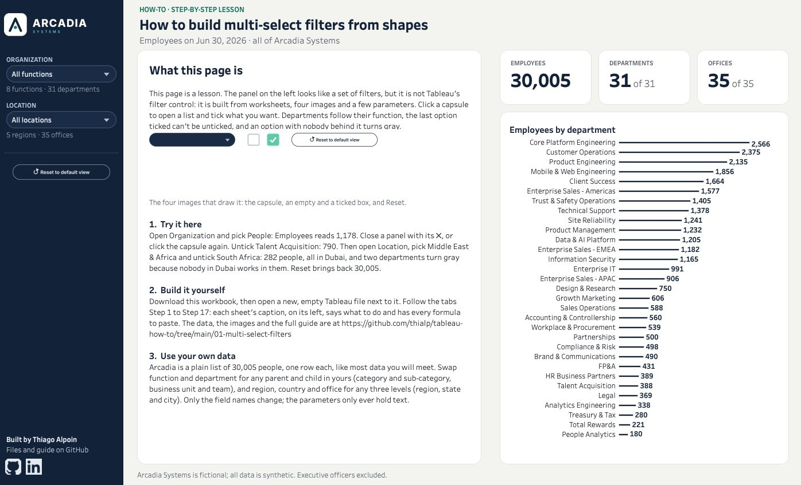

# How-To #1: multi-select filters with clicks and images

Build the filter panel below from an empty Tableau workbook: a button that opens a panel, a list you tick and untick, departments that follow their function, a last option that can't be unticked, and options that gray out when nobody is behind them. Every step is a calculation or a click in Tableau. There is no SQL and no extension.

[](https://public.tableau.com/app/profile/thialp/viz/HowtoBuildMulti-SelectFiltersfromShapesArcadiaHow-To/Multi-selectfilters)

**[Try it live on Tableau Public](https://public.tableau.com/app/profile/thialp/viz/HowtoBuildMulti-SelectFiltersfromShapesArcadiaHow-To/Multi-selectfilters)**, or download the workbook there (the download icon under the viz) to open every step's sheet.

**What you need:** Tableau Desktop or Tableau Public (the free app), version 2022.3 or later (for showing and hiding containers with a parameter). Plan on about two hours.

**How the lesson works.** There are 17 steps, and each one builds one worksheet. The [downloadable workbook on Tableau Public](https://public.tableau.com/app/profile/thialp/viz/HowtoBuildMulti-SelectFiltersfromShapesArcadiaHow-To/Multi-selectfilters) has the same 17 sheets, named **Step 1 · Try It** to **Step 17 · Title**; each sheet's caption (on its left) holds that step's instructions and every formula to paste. So you can follow this page, the workbook, or both side by side.

**What you'll learn**

| Steps | Technique | Used for |
|---|---|---|
| 2 | An image as a button: a one-mark sheet, a custom shape, a parameter action | The rail capsule that opens a panel |
| 2–3 | Show and hide a container with a parameter | The panel itself, and its ✕ |
| 3 | The deselect trick | Buttons that never stay highlighted |
| 4 | A string parameter as a list | Picking several options with a click each |
| 5 | Storing what's left out instead of what's in | Departments that start ticked when you pick their function |
| 5 | Cleaning up with `REGEXP_REPLACE` | A function click that also resets its departments |
| 5 | A guard on the last option | No click can lead to an empty page |
| 7–12 | The same pattern one level deeper, on your own | Region, country and office |
| 12 | Graying out options with nobody behind them | Two filters that respect each other |
| 13 | Reset to default view | One click back to the start |
| 14–17 | Results you can watch | Number cards, the chart and the finished page |

Arcadia Systems is a fictional company. All data is synthetic.

---

## Contents

- [0. Get ready](#0-get-ready)
   - [0.1 Download the files](#01-download-the-files)
   - [0.2 Install the shapes](#02-install-the-shapes)
   - [0.3 Connect the data](#03-connect-the-data)
   - [0.4 Two helper fields you'll use all the time](#04-two-helper-fields-youll-use-all-the-time)
- [Part 1: a chart to watch, and a button made of an image](#part-1-a-chart-to-watch-and-a-button-made-of-an-image)
   - [Step 1: the chart you'll watch](#step-1-the-chart-youll-watch)
   - [Step 2: the capsule, and the panel it opens](#step-2-the-capsule-and-the-panel-it-opens)
   - [Step 3: the ✕, and buttons that never stay highlighted](#step-3-the--and-buttons-that-never-stay-highlighted)
- [Part 2: a list you can tick](#part-2-a-list-you-can-tick)
   - [Step 4: the function list](#step-4-the-function-list)
   - [Step 5: departments that follow their function](#step-5-departments-that-follow-their-function)
   - [Step 6: make the capsule talk](#step-6-make-the-capsule-talk)
- [Part 3: two filters that respect each other](#part-3-two-filters-that-respect-each-other)
   - [Step 7: your turn, Location](#step-7-your-turn-location)
   - [Step 8: the Location sub-line](#step-8-the-location-sub-line)
   - [Step 9: the Location ✕](#step-9-the-location-)
   - [Step 10: the region list](#step-10-the-region-list)
   - [Step 11: the country list](#step-11-the-country-list)
   - [Step 12: the office list, then gray out what's empty](#step-12-the-office-list-then-gray-out-whats-empty)
- [Part 4: reset, and the finished page](#part-4-reset-and-the-finished-page)
   - [Step 13: reset to default view](#step-13-reset-to-default-view)
   - [Step 14: the employees card](#step-14-the-employees-card)
   - [Step 15: the departments card](#step-15-the-departments-card)
   - [Step 16: the offices card](#step-16-the-offices-card)
   - [Step 17: the title, and the finished page](#step-17-the-title-and-the-finished-page)
- [Use it on your own data](#use-it-on-your-own-data)
- [Checks](#checks)
- [Why it works this way](#why-it-works-this-way)

---

## 0. Get ready

### 0.1 Download the files

Download **[multi-select-filters-files.zip](https://github.com/thialp/tableau-how-to/raw/main/01-multi-select-filters/multi-select-filters-files.zip)** and unzip it. You get:

- `arcadia_employees.csv`: 30,005 employees, one row each, on Jun 30, 2026;
- a folder **Arcadia How-To** with the seven images the page is drawn with.

Want to restyle the images? They're drawn in the [Arcadia Analytics · Tableau UI Kit](https://www.figma.com/community/file/1690422855000144024) on Figma: open it, change the colors, and export at 2×. You don't need Figma to follow this guide.

### 0.2 Install the shapes

Move the folder **Arcadia How-To** into:

- Windows: `Documents\My Tableau Repository\Shapes\`
- Mac: `Documents/My Tableau Repository/Shapes/`

| File | Size (px) | What it draws |
|---|---|---|
| `capsule_dark.png` | 600 × 96 | The rail button |
| `tick_on.png` | 36 × 36 | A ticked box (teal, white tick) |
| `tick_off.png` | 36 × 36 | An empty box |
| `reset_button.png` | 600 × 96 | "Reset to default view" (Step 13) |
| `popover_line.png` | 1248 × 18 | The thin line under a panel's title |
| `rail_divider.png` | 400 × 48 | The line across the rail |
| `arcadia_logo_reverse.png` | 1200 × 326 | The logo for the rail |

The images are drawn at twice their on-screen size, so they stay sharp on high-resolution screens. If Tableau was open, restart it, or click **Reload Shapes** in the shape picker, so it sees the new folder.

### 0.3 Connect the data

1. Open Tableau. **Connect > To a File > Text file**, and pick `arcadia_employees.csv`.
2. Check the types on the Data Source page: `as_of_date` and `hire_date` are dates; every other column is a string (Abc).
3. Go to Sheet 1. **File > Save As** `Multi-select filters.twbx` (Tableau Public saves to your profile instead; that's fine).

**You should see** 13 fields in the Data pane, plus `arcadia_employees.csv (Count)`. Drag `arcadia_employees.csv (Count)` to Text: **30,005**.

### 0.4 Two helper fields you'll use all the time

Create these now (**Analysis > Create Calculated Field**). Each formula box below starts with a `//` line naming the field; type that name in the name box and paste the rest.

```
// Employees
COUNT([employee_id])
```

```
// One
1
```

`Employees` is the number you show. `One` is a 1 on every row, so `SUM(IF ... THEN [One] END)` counts the rows that pass a test, which is how the lists will ask "is anybody behind this option?"

## Part 1: a chart to watch, and a button made of an image

### Step 1: the chart you'll watch

Every step changes what this one sheet shows, so you can see your work.

1. New sheet, name it **Try It**.
2. `department_name` on Rows, `Employees` on Columns, sort descending. Drag `Employees` to Label.
3. Color one navy, `#13233A`.

**You should see** 31 bars, starting with Core Platform Engineering. Leave it like this; in Step 4 you'll add one filter to it.

**Tidy it for the finished page**, where it sits in a narrow column: title hidden; rows a fixed **17 px** high (Format > Cell size, or drag a row border), so a short list doesn't stretch into giant bars and all 31 departments fit the card without a scroll bar; View **Fit Width**; bar size about a third of the slider; label `<Employees>` Tableau Semibold 9 navy at the end of each bar; the Columns axis hidden; tooltip `<department_name>` / `<Employees> employees in scope`, command buttons off.

> **If the sheet shows nothing at all**, look for a red pill on the Marks card. A field that is already on Rows doesn't also need to sit on Tooltip; Tableau can mark the second copy invalid, and an invalid field blanks the whole view. Insert it into the tooltip text instead, which works because every field in the view is available there.

---

The rail capsules on the [Arcadia dashboards](https://public.tableau.com/app/profile/thialp) aren't Tableau filters. Each is a sheet with exactly one mark. The mark is drawn with a custom shape (the capsule picture), its label is the text, and a click on it runs a parameter action. That's the whole idea of an image button.

### Step 2: the capsule, and the panel it opens

**Why.** A sheet with no dimension in the view draws one mark. Give that mark a picture and a click action, and you have a button you can style any way you like.

**Do.**

1. Create a parameter: right-click in the Data pane > **Create Parameter**.

   | Name | Data type | Current value |
   |---|---|---|
   | `p_OrgOpen` | Boolean | False |

   Boolean parameters show True and False; that's all we need. Repeat for **`p_LocOpen`** (Boolean, False), which you'll use in Step 7.

2. Create these calculated fields:

```
// Toggle Org Panel
NOT [p_OrgOpen]
```

```
// Close Panel
FALSE
```

```
// zzTrue
TRUE
```

```
// zzFalse
FALSE
```

```
// Org Capsule Shape
"capsule_dark"
```

```
// Org Field Text
"All functions"
```

`Org Field Text` is a placeholder: Step 6 makes it follow the selection. `Org Capsule Shape` stays as it is; the capsule is the same navy picture whatever you pick, and the text on it does the talking.

3. New sheet, name it **Org Field**.
   - Marks type **Shape**. Drag `Org Capsule Shape` to Shape. Click **Shape**, pick the palette **Arcadia How-To**, and assign `capsule_dark.png` to the value `capsule_dark`.
   - Drag `Org Field Text` to Label. Click **Label**: font Tableau Semibold 9, color `#E4E9F0`; Alignment horizontal **left**, vertical **middle**.
   - Drag `Toggle Org Panel`, `Close Panel`, `zzTrue` and `zzFalse` to Detail. They don't draw anything; actions can only read fields that are in the view.
   - Size: drag the size slider until the capsule fills the cell. If the label sits on top of the image, add two or three leading spaces inside the label text, before `<Org Field Text>`.
   - **Format > Shading**: worksheet None. **Format > Borders** and **Lines**: None everywhere. Tooltip: open it and type `Choose functions and departments`, untick **Include command buttons**.

**You should see** one dark capsule reading "All functions", and nothing else on the sheet.

**Try it.** Click the capsule. It highlights and stays highlighted. Step 3 fixes that.

#### The panel that opens

**Why.** A dashboard container can be shown or hidden by a Boolean parameter. The capsule click flips the parameter, so the container appears and disappears.

**Do.**

1. Create a new dashboard, **Multi-select filters**, size **Fixed 1400 × 850**. Shading `#F3F3EF`.
2. Drag a **Vertical** container onto the dashboard, **floating**: x 0, y 0, w 216, h 850. Background navy `#13233A`. This is the rail.
3. Drag **Org Field** into the rail. Hide its title. Fixed height 32.
4. Drag another **Vertical** container, floating, to x 216, y 96, w 640, h 700. Its top lines up with the ORGANIZATION heading in the rail. Background `#13233A`, no border. Name it **Org Popover** (Layout pane > Item hierarchy, double-click the name).
5. Into **Org Popover** drag a **Text** object: `Organization`, Tableau Bold 12, white. Fixed height 44. This is the panel's title; Step 3 adds the ✕ beside it.
6. Select **Org Popover**. In the Layout pane tick **Control visibility using value**, and pick **Parameters > p_OrgOpen**.
7. **Dashboard > Actions > Add Action > Change Parameter**:

   | Name | Source sheet | Run on | Target parameter | Source field | Aggregation | Clearing the selection |
   |---|---|---|---|---|---|---|
   | Open org popover | Org Field | Select | p_OrgOpen | Toggle Org Panel | None | Keep current value |

**You should see** a navy rail with the capsule and no panel. Click the capsule: the panel appears. Click it again: the panel... doesn't close. Why? The first click left the capsule selected, so the second click only clears the selection, and clearing keeps the parameter as it was. That's Step 3.

---

### Step 3: the ✕, and buttons that never stay highlighted

**Why.** A selected mark stays selected until you click it again, and that second click is spent on unselecting instead of running your action. The fix is the **deselect trick**: a Filter action on the same sheet that maps `zzTrue` to `zzFalse`. On every click it asks Tableau to keep only rows where TRUE equals FALSE. No row qualifies, so Tableau drops the selection at once, and because the action clears to **Show all values**, nothing disappears. Every click is now a fresh click.

**Do.**

1. **Dashboard > Actions > Add Action > Filter**:

   | Name | Source | Run on | Target | Clearing the selection | Filter |
   |---|---|---|---|---|---|
   | Deselect Org Field | Org Field (this dashboard) | Select | Org Field | Show all values | Selected fields: `zzTrue` → `zzFalse` |

   Under **Target Filters**, choose **Selected Fields**, Source field `zzTrue`, Target field `zzFalse`.

2. Create

   ```
   // Close X
   "✕"
   ```

   New sheet **Org Close**: Marks **Text**; drag `Close X` to Text (Tableau Book 12, `#B8C0CC`), centered. Why a field and not typed text: a Text sheet with no field on it draws Tableau's "Abc" placeholder instead of your text. Detail `Close Panel`, `zzTrue`, `zzFalse`. Tooltip `Close`, command buttons off. Shading None.
3. On the dashboard, put a **Horizontal** container at the top of **Org Popover** in place of the title text: the title text on the left (width 596), **Org Close** on the right (width 44), height 44.
4. Two actions:

   | Name | Type | Source | Target | Field |
   |---|---|---|---|---|
   | Org popover on ✕ | Change Parameter | Org Close | p_OrgOpen | Close Panel |
   | Deselect Org Close | Filter | Org Close | Org Close | `zzTrue` → `zzFalse` |

5. One panel at a time. Add:

   | Name | Type | Source | Target | Field |
   |---|---|---|---|---|
   | Org closes Loc | Change Parameter | Org Field | p_LocOpen | Close Panel |

   The Location capsule (Step 7) gets the mirror action, so opening one closes the other.

**You should see** the capsule open and close the panel on every click, the ✕ close it, and nothing ever stay highlighted.

**Rule for the rest of this guide:** every sheet you click gets its own deselect action (`zzTrue` → `zzFalse`, Show all values), and `zzTrue` and `zzFalse` on its Detail. Every tooltip has **Include command buttons** unticked.

---

## Part 2: a list you can tick

Tableau has no parameter that holds several values. So we keep them in a string: `|People|Finance|`. Each name sits between two bars, so `CONTAINS([p_Functions], "|People|")` tests for one name without matching a longer one by accident. An empty string means "everything".

### Step 4: the function list

#### A parameter that holds a list

**Do.**

1. Create two parameters:

   | Name | Data type | Current value | Holds |
   |---|---|---|---|
   | `p_Functions` | String | (empty) | The functions you ticked: `\|People\|Finance\|` |
   | `p_DeptOff` | String | (empty) | The departments you **un**ticked: `\|People>Talent Acquisition\|` |

   Why the second one stores what's left out comes in Step 5.

2. Create:

```
// Function In
[p_Functions] = "" OR CONTAINS([p_Functions], "|" + [function_name] + "|")
```

```
// Dept Key
[function_name] + ">" + [department_name]
```

```
// Dept In
[Function In] AND NOT CONTAINS([p_DeptOff], "|" + [Dept Key] + "|")
```

```
// In Scope
[Dept In]
```

3. On **Try It**, drag `In Scope` to Filters and keep **True**. Right-click the filter > **Apply to Worksheets > All Using This Data Source** is **not** what you want: keep it on Try It only. The lists must always see every option.

**Try it.** Show the parameter control for `p_Functions` (right-click > Show Parameter) and type `|People|`. Try It shows four bars: HR Business Partners 389, Talent Acquisition 388, Total Rewards 221, People Analytics 180. Type `|People|Finance|`: seven bars. Then type `|People>Talent Acquisition|` into `p_DeptOff`: Talent Acquisition goes. Empty both boxes and hide the controls again; from now on clicks will write them.

#### The list itself

**Why.** One click must add the name if it isn't in the string, and take it out if it is. A calculation can build the new string for each mark, and a parameter action writes the string of the mark you clicked.

**Do.**

1. Create:

```
// Function Toggle
IF CONTAINS([p_Functions], "|" + [function_name] + "|")
THEN (IF [p_Functions] = "|" + [function_name] + "|" THEN ""
      ELSE REPLACE([p_Functions], "|" + [function_name] + "|", "|") END)
ELSE (IF [p_Functions] = "" THEN "|" + [function_name] + "|"
      ELSE [p_Functions] + [function_name] + "|" END)
END
```

```
// Function Pick
MIN([Function Toggle])
```

```
// Function Shape
IF [p_Functions] <> "" AND MIN([Function In]) THEN "tick_on" ELSE "tick_off" END
```

```
// Tick X
MIN(0.6)
```

`Tick X` puts every box at the same spot near the left of a 0-to-10 axis, a little in from the edge so the box isn't cut in half.

Reading `Function Toggle` for People: if `|People|` is in the string, remove it (and if it was the only one, leave the string empty); otherwise append it. `Function Pick` wraps it in `MIN()` so the action has one value per mark.

Why the ticks are all empty at the start: with nothing chosen, every function is in, but none is "picked". Empty boxes read as "no choice yet", which is what the capsule's "All functions" says.

2. New sheet **Function List**:
   - Rows `function_name` (header hidden: right-click > untick **Show Header**). Columns `Tick X`; right-click the axis > Edit Axis: Fixed **0 to 10**; then untick **Show Header**.
   - Marks **Shape**, Shape `Function Shape`: assign `tick_on.png` to `tick_on` and `tick_off.png` to `tick_off` (palette Arcadia How-To). Size: one step left of the middle of the slider; keep this size on every list.
   - Label: type two spaces, then insert `function_name`: `  <function_name>`. Tableau Book 10, `#E4E9F0`; alignment left, middle. Under Label, tick **Allow labels to overlap other marks**.
   - Detail `Function Pick`, `zzTrue`, `zzFalse`.
   - Format: shading None, row and column dividers None, grid lines None, zero lines None. Fit **Entire View**. Tooltip off (Tooltip > untick **Show tooltips**).
3. On your dashboard, put **Function List** inside **Org Popover**, under the title, width 200.
4. Actions:

   | Name | Type | Source | Target | Field |
   |---|---|---|---|---|
   | Toggle function | Change Parameter | Function List | p_Functions | Function Pick (aggregation None) |
   | Deselect Function List | Filter | Function List | Function List | `zzTrue` → `zzFalse` |

**You should see** eight empty boxes, Commercial to Technology. Click People: it ticks, and Try It shows only People's four departments. Click Finance: both ticked, seven bars. Click People again: only Finance remains. Click Finance: empty again, 31 bars.

---

### Step 5: departments that follow their function

**Why.** When you pick People, you expect all four People departments to be in, and then you untick the one you don't want. So the department parameter stores **exclusions**: a department is in when its function is in and it isn't on the "off" list. Every department of a newly picked function starts ticked, with no extra work.

There's one catch. Say you untick Talent Acquisition, then untick People, then pick People again. You'd expect a fresh start, but `|People>Talent Acquisition|` is still in `p_DeptOff`. So a function click also cleans its own departments out of the "off" list. That's what the `>` in `Dept Key` is for: every People department starts with `|People>`, and one regular expression removes them all.

**Do.**

1. Create:

```
// DeptOff Without Function
IF REGEXP_REPLACE([p_DeptOff], "\|" + [function_name] + ">[^|]*", "") = "|" THEN ""
ELSE REGEXP_REPLACE([p_DeptOff], "\|" + [function_name] + ">[^|]*", "") END
```

```
// Function DeptOff Pick
MIN([DeptOff Without Function])
```

```
// Dept Visible
[Function In]
```

```
// Dept Ticked
MIN([Dept In])
```

```
// Dept Toggle
IF CONTAINS([p_DeptOff], "|" + [Dept Key] + "|")
THEN (IF [p_DeptOff] = "|" + [Dept Key] + "|" THEN ""
      ELSE REPLACE([p_DeptOff], "|" + [Dept Key] + "|", "|") END)
ELSE (IF [p_DeptOff] = "" THEN "|" + [Dept Key] + "|"
      ELSE [p_DeptOff] + [Dept Key] + "|" END)
END
```

```
// Dept Pick
MIN([Dept Toggle])
```

```
// Dept Shape
IF [Dept Ticked] THEN "tick_on" ELSE "tick_off" END
```

How the clean-up reads: `"\|People>[^|]*"` matches a bar, `People>`, and everything up to the next bar, which is one People department. Replacing every match with nothing leaves the bars of the other departments. If only a lone `|` is left, the result is empty.

Worked example, with `p_DeptOff` = `|People>Talent Acquisition|Finance>FP&A|`: a click on People leaves `|Finance>FP&A|`. With only `|People>Talent Acquisition|`, it leaves `|`, which becomes empty.

> **Names with special characters.** `REGEXP_REPLACE` reads `( ) [ ] . + * ? ^ $ \` as instructions. None of the Arcadia function names has them. If yours do, escape them first, for example with `REPLACE([name], ".", "\.")`.

2. Add `Function DeptOff Pick` to **Function List**'s Detail, and this action:

   | Name | Type | Source | Target | Field |
   |---|---|---|---|---|
   | Function cleans departments | Change Parameter | Function List | p_DeptOff | Function DeptOff Pick (None) |

   Both actions on Function List run on the same click.

3. New sheet **Dept List**, built like Function List:
   - Filter `Dept Visible` = True. (This filter is fine: it hides departments of unpicked functions, which is what the panel should do.)
   - Rows `Dept Key`, header hidden. Because the key starts with the function, the departments come out sorted by function, so each function's departments sit together. Columns `Tick X`, Fixed 0 to 10, hidden.

     Why not `function_name` then `department_name` as two row headers? A group with a single row loses its heading in Tableau, so in Location (Step 7), every country with one office would show a blank. One flat list, sorted by its key, avoids that everywhere.
   - Shape `Dept Shape` (`tick_on`, `tick_off`); Label `  <department_name>`; Detail `Dept Pick`, `zzTrue`, `zzFalse`.
   - Same format and tooltip-off as Function List.
4. Put **Dept List** in **Org Popover** to the right of Function List (width 420). Actions:

   | Name | Type | Source | Target | Field |
   |---|---|---|---|---|
   | Toggle department | Change Parameter | Dept List | p_DeptOff | Dept Pick (None) |
   | Deselect Dept List | Filter | Dept List | Dept List | `zzTrue` → `zzFalse` |

**You should see** all 31 departments ticked under their functions when nothing is picked. Pick People: only People's four show, all ticked. Untick Talent Acquisition: Try It shows 3 bars, 790 people. Untick People, then pick it again: all four are back. That's the clean-up.

#### The last one ticked stays

**Why.** Untick every department of a function and the page has nothing to show. Instead, the last ticked department locks: its click writes back the string as it was, so nothing changes.

**Do.**

1. Create:

```
// Dept Scope
SUM(IF [Dept In] THEN [One] END)
```

```
// Scope Total
MIN({ FIXED : SUM(IF [Dept In] THEN [One] END) })
```

```
// Dept Locked
[Dept Ticked] AND ZN([Scope Total]) - ZN([Dept Scope]) = 0
```

`Scope Total` counts everyone in scope across the whole data source (the `{ FIXED : … }` ignores the view's rows). `Dept Scope` counts the people in this department who are in scope. When the two are equal, this department holds everyone in scope, so it is the last one ticked.

2. Edit two fields:

```
// Dept Pick
IF [Dept Locked] THEN [p_DeptOff] ELSE MIN([Dept Toggle]) END
```

```
// Dept Shape
IF [Dept Ticked] THEN "tick_on" ELSE "tick_off" END
```

(`Dept Shape` stays as it is: a locked department is still ticked.)

3. Make the locked name read differently. Create:

```
// Dept Name On
IF NOT [Dept Locked] THEN MIN([department_name]) END
```

```
// Dept Name Locked
IF [Dept Locked] THEN MIN([department_name]) END
```

On **Dept List**, replace the label with two runs on one line: `  <Dept Name On><Dept Name Locked>`. Color the first run `#E4E9F0` and the second `#8FA0B8`. Only one of them has a value for any department, so each name shows once, in the right color.

**You should see** this: pick Legal & Compliance, then untick Legal. Compliance & Risk turns gray, and a click on it changes nothing. Try It still shows its 498 people.

> **Why `ZN()`?** A sum over no rows is NULL in Tableau, not 0. `ZN()` turns it into 0 so the comparison works.

---

### Step 6: make the capsule talk

**Why.** "All functions" should change to say what you picked, and the line under the capsule should say how much of the organization is in.

**Do.**

1. Create:

```
// Org Is All
[p_Functions] = "" AND [p_DeptOff] = ""
```

```
// N Functions In
{ COUNTD(IF [Function In] THEN [function_name] END) }
```

```
// One Function
{ MIN(IF [Function In] THEN [function_name] END) }
```

```
// N Functions
{ COUNTD([function_name]) }
```

```
// N Depts
{ COUNTD([department_name]) }
```

```
// N Depts In
{ COUNTD(IF [Dept In] THEN [department_name] END) }
```

```
// N Depts Offered
{ COUNTD(IF [Function In] THEN [department_name] END) }
```

The curly braces with nothing before the colon are a FIXED level of detail over the whole data source, written short. They give one number however the sheet is built.

2. Edit the placeholder from Step 2, and add the sub-line:

```
// Org Field Text
IF [p_Functions] = "" THEN "All functions"
ELSEIF [N Functions In] = 1 THEN [One Function]
ELSE STR([N Functions In]) + " functions" END
```

```
// Org Sub Text
IF [Org Is All] THEN STR([N Functions]) + " functions · " + STR([N Depts]) + " departments"
ELSE STR([N Depts In]) + " of " + STR([N Depts Offered]) + " departments" END
```

3. On **Org Field**, the label `<Org Field Text>` (Tableau Medium 9, `#E4E9F0`) now follows the selection by itself.
4. New sheet **Org Sub**: Marks Text, `<Org Sub Text>` Tableau Book 9 `#8A97A8`, left. Detail `zzTrue`, `zzFalse`; tooltip off; deselect action. Put it in the rail under Org Field, height 18.
5. Put a text object `ORGANIZATION` (Tableau Semibold 8, `#B8C4D6`) above the capsule.

**You should see**

| You pick | Capsule | Under it |
|---|---|---|
| Nothing | "All functions" | 8 functions · 31 departments |
| People | "People" | 4 of 4 departments |
| People, Talent Acquisition unticked | "People" | 3 of 4 departments |
| People and Finance | "2 functions" | 7 of 7 departments |

---

## Part 3: two filters that respect each other

### Step 7: your turn, Location

Build the Location filter yourself, with the same pattern one level deeper: **region > country > office**. This step makes the capsule and every Location field; Steps 8 to 12 build the other Location sheets. Use the hints first; the full answer is below them, and the finished Location sheets are in the downloadable workbook (Loc Field, Region List, Country List, Office List and the rest), so you can open them and compare.

**Hints**

- Three string parameters: `p_Regions` holds picked regions; `p_CountryOff` and `p_OfficeOff` hold exclusions.
- Keys carry their parents: `[region] + ">" + [country_name]`, and `[region] + ">" + [country_name] + ">" + [office_name]`.
- A region click cleans **both** its countries and its offices; a country click cleans its offices.
- `In Scope` becomes `[Dept In] AND [Office In]`.
- The Location capsule reads `All locations`, a region, or `2 regions`; under it `5 regions · 35 offices`, or for a selection `6 countries · 8 of 9 offices`.

<details>
<summary><b>The answer: every Location field</b></summary>

Parameters: `p_Regions`, `p_CountryOff`, `p_OfficeOff`, all String, empty.

```
// Region In
[p_Regions] = "" OR CONTAINS([p_Regions], "|" + [region] + "|")

// Country Key
[region] + ">" + [country_name]

// Country In
[Region In] AND NOT CONTAINS([p_CountryOff], "|" + [Country Key] + "|")

// Office Key
[region] + ">" + [country_name] + ">" + [office_name]

// Office In
[Country In] AND NOT CONTAINS([p_OfficeOff], "|" + [Office Key] + "|")

// In Scope
[Dept In] AND [Office In]

// Region Toggle
IF CONTAINS([p_Regions], "|" + [region] + "|")
THEN (IF [p_Regions] = "|" + [region] + "|" THEN "" ELSE REPLACE([p_Regions], "|" + [region] + "|", "|") END)
ELSE (IF [p_Regions] = "" THEN "|" + [region] + "|" ELSE [p_Regions] + [region] + "|" END) END

// Region Pick
MIN([Region Toggle])

// CountryOff Without Region
IF REGEXP_REPLACE([p_CountryOff], "\|" + [region] + ">[^|]*", "") = "|" THEN ""
ELSE REGEXP_REPLACE([p_CountryOff], "\|" + [region] + ">[^|]*", "") END

// OfficeOff Without Region
IF REGEXP_REPLACE([p_OfficeOff], "\|" + [region] + ">[^|]*", "") = "|" THEN ""
ELSE REGEXP_REPLACE([p_OfficeOff], "\|" + [region] + ">[^|]*", "") END

// Region CountryOff Pick
MIN([CountryOff Without Region])

// Region OfficeOff Pick
MIN([OfficeOff Without Region])

// Region Shape
IF [p_Regions] <> "" AND MIN([Region In]) THEN "tick_on" ELSE "tick_off" END

// Country Visible
[Region In]

// Country Ticked
MIN([Country In])

// Country Toggle
IF CONTAINS([p_CountryOff], "|" + [Country Key] + "|")
THEN (IF [p_CountryOff] = "|" + [Country Key] + "|" THEN "" ELSE REPLACE([p_CountryOff], "|" + [Country Key] + "|", "|") END)
ELSE (IF [p_CountryOff] = "" THEN "|" + [Country Key] + "|" ELSE [p_CountryOff] + [Country Key] + "|" END) END

// OfficeOff Without Country
IF REGEXP_REPLACE([p_OfficeOff], "\|" + [Country Key] + ">[^|]*", "") = "|" THEN ""
ELSE REGEXP_REPLACE([p_OfficeOff], "\|" + [Country Key] + ">[^|]*", "") END

// Country Scope
SUM(IF [Dept In] AND [Office In] THEN [One] END)

// Country Locked
[Country Ticked] AND ZN([Scope Total]) - ZN([Country Scope]) = 0

// Country Pick
IF [Country Locked] THEN [p_CountryOff] ELSE MIN([Country Toggle]) END

// Country OfficeOff Pick
IF [Country Locked] THEN [p_OfficeOff] ELSE MIN([OfficeOff Without Country]) END

// Country Shape
IF [Country Ticked] THEN "tick_on" ELSE "tick_off" END

// Office Visible
[Country In]

// Office Ticked
MIN([Office In])

// Office Toggle
IF CONTAINS([p_OfficeOff], "|" + [Office Key] + "|")
THEN (IF [p_OfficeOff] = "|" + [Office Key] + "|" THEN "" ELSE REPLACE([p_OfficeOff], "|" + [Office Key] + "|", "|") END)
ELSE (IF [p_OfficeOff] = "" THEN "|" + [Office Key] + "|" ELSE [p_OfficeOff] + [Office Key] + "|" END) END

// Office Scope
SUM(IF [Dept In] AND [Office In] THEN [One] END)

// Office Locked
[Office Ticked] AND ZN([Scope Total]) - ZN([Office Scope]) = 0

// Office Pick
IF [Office Locked] THEN [p_OfficeOff] ELSE MIN([Office Toggle]) END

// Office Shape
IF [Office Ticked] THEN "tick_on" ELSE "tick_off" END

// Loc Is All
[p_Regions] = "" AND [p_CountryOff] = "" AND [p_OfficeOff] = ""

// N Regions
{ COUNTD([region]) }

// N Offices
{ COUNTD([office_name]) }

// N Regions In
{ COUNTD(IF [Region In] THEN [region] END) }

// One Region
{ MIN(IF [Region In] THEN [region] END) }

// N Countries In
{ COUNTD(IF [Country In] THEN [country_name] END) }

// N Offices In
{ COUNTD(IF [Office In] THEN [office_name] END) }

// N Offices Offered
{ COUNTD(IF [Region In] THEN [office_name] END) }

// Loc Field Text
IF [p_Regions] = "" THEN "All locations"
ELSEIF [N Regions In] = 1 THEN [One Region]
ELSE STR([N Regions In]) + " regions" END

// Loc Capsule Shape
"capsule_dark"

// Loc Sub Text
IF [Loc Is All] THEN STR([N Regions]) + " regions · " + STR([N Offices]) + " offices"
ELSE STR([N Countries In]) + " countries · " + STR([N Offices In]) + " of " + STR([N Offices Offered]) + " offices" END

// Toggle Loc Panel
NOT [p_LocOpen]
```

Also edit, now that Location exists, so a lock counts only the people the page shows:

```
// Dept Scope
SUM(IF [Dept In] AND [Office In] THEN [One] END)

// Scope Total
MIN({ FIXED : SUM(IF [Dept In] AND [Office In] THEN [One] END) })
```

Sheets: **Loc Field**, **Loc Sub**, **Loc Close**, **Region List** (Rows `region`), **Country List** (Filter `Country Visible` = True; Rows `Country Key`, header hidden; label `  <country_name>`), **Office List** (Filter `Office Visible` = True; Rows `Office Key`, header hidden; label `  <ATTR(country_name)> · <office_name>`, the country in `#8FA0B8`), each built like its Organization twin. Locked names use the two-run label of Step 5.

Popover **Loc Popover**: floating at x 216, y 96, w 640, h 744 (the same top as Organization, down to the foot of the page, so all 35 offices fit without a scroll bar), visibility `p_LocOpen`; Region List 170, Country List 190, Office List 280.

Actions (plus a deselect on every one of these sheets):

| Name | Source | Target | Field |
|---|---|---|---|
| Open loc popover | Loc Field | p_LocOpen | Toggle Loc Panel |
| Loc closes Org | Loc Field | p_OrgOpen | Close Panel |
| Loc popover on ✕ | Loc Close | p_LocOpen | Close Panel |
| Toggle region | Region List | p_Regions | Region Pick |
| Region cleans countries | Region List | p_CountryOff | Region CountryOff Pick |
| Region cleans offices | Region List | p_OfficeOff | Region OfficeOff Pick |
| Toggle country | Country List | p_CountryOff | Country Pick |
| Country cleans offices | Country List | p_OfficeOff | Country OfficeOff Pick |
| Toggle office | Office List | p_OfficeOff | Office Pick |

</details>

**You should see**

| You pick | Capsule | Under it | Try It total |
|---|---|---|---|
| Nothing | "All locations" | 5 regions · 35 offices | 30,005 |
| Asia Pacific | "Asia Pacific" | 6 countries · 9 of 9 offices | 9,005 |
| Asia Pacific, Pune unticked | "Asia Pacific" | 6 countries · 8 of 9 offices | 8,527 |
| That, plus People without Talent Acquisition | | | 143 |

To read the total on Try It, turn on **Analysis > Totals > Show Column Grand Totals**.

---

### Step 8: the Location sub-line

Sheet **Loc Sub**, built like Org Sub in Step 6: Marks **Text**, `<Loc Sub Text>` Tableau Book 9 `#8A97A8`, left. Detail `zzTrue`, `zzFalse`; tooltip off; a deselect action. In the rail under Loc Field, height 18.

**You should see** "5 regions · 35 offices" with nothing chosen.

---

### Step 9: the Location ✕

Sheet **Loc Close**, built like Org Close in Step 3: Marks **Text**, `Close X` on Text (Tableau Book 12, `#B8C0CC`), centered. Detail `Close Panel`, `zzTrue`, `zzFalse`. Tooltip `Close`, command buttons off. Put it at the right of the Loc Popover's title row.

Actions: **Loc popover on ✕** (Change Parameter, Loc Close, `p_LocOpen` ← `Close Panel`) and **Deselect Loc Close**.

---

### Step 10: the region list

Sheet **Region List**, built like Function List in Step 4: Rows `region` (header hidden); Columns `Tick X`, Fixed 0 to 10, hidden; Marks **Shape**, Shape `Region Shape` (`tick_on`, `tick_off`); label `  <region>`; Detail `Region Pick`, `Region CountryOff Pick`, `Region OfficeOff Pick`, `zzTrue`, `zzFalse`; tooltip off; Fit Entire View.

Actions: **Toggle region** (`p_Regions` ← `Region Pick`), **Region cleans countries** (`p_CountryOff` ← `Region CountryOff Pick`), **Region cleans offices** (`p_OfficeOff` ← `Region OfficeOff Pick`), and the deselect. Put it in the Loc Popover's body, width 170.

**You should see** five empty boxes, Asia Pacific to North America. Pick Asia Pacific: Try It shows 9,005 people.

---

### Step 11: the country list

Sheet **Country List**, built like Dept List in Step 5: Filter `Country Visible` = True; Rows `Country Key` (header hidden); Columns `Tick X`, hidden; Shape `Country Shape`; label in two runs, `  <Country Name On>` `#E4E9F0` and `<Country Name Locked>` `#8FA0B8`, with

```
// Country Name On
IF NOT [Country Locked] THEN MIN([country_name]) END
```

```
// Country Name Locked
IF [Country Locked] THEN MIN([country_name]) END
```

Detail `Country Pick`, `Country OfficeOff Pick`, `zzTrue`, `zzFalse`. Actions: **Toggle country** (`p_CountryOff` ← `Country Pick`), **Country cleans offices** (`p_OfficeOff` ← `Country OfficeOff Pick`), and the deselect. In the Loc Popover, width 190.

**You should see** all 22 countries ticked. Pick Asia Pacific: only its six countries show.

---

### Step 12: the office list, then gray out what's empty

Sheet **Office List**, the last list: Filter `Office Visible` = True; Rows `Office Key` (header hidden); Columns `Tick X`, hidden; Shape `Office Shape`; label `  <ATTR(country_name)> · ` in `#8FA0B8`, then `<Office Name On>` `#E4E9F0` and `<Office Name Locked>` `#8FA0B8`, with

```
// Office Name On
IF NOT [Office Locked] THEN MIN([office_name]) END
```

```
// Office Name Locked
IF [Office Locked] THEN MIN([office_name]) END
```

Detail `Office Pick`, `zzTrue`, `zzFalse`. Actions: **Toggle office** (`p_OfficeOff` ← `Office Pick`) and the deselect. In the Loc Popover, width 280.

With the office list done, both filters exist. The last piece is making them respect each other.

#### Gray out what's empty

**Why.** Pick Middle East & Africa and untick South Africa, so only Dubai is left. Then open Organization: Analytics Engineering and People Analytics have nobody in Dubai. Ticking them would show nothing, so they should look disabled and do nothing when clicked. The same goes the other way: pick Finance, then open Location, and Portugal has no Finance employees.

The test is the same everywhere: does anybody pass **the other filter**? A department looks at the location filter; a country or office looks at the organization filter.

**Do.**

1. Create:

```
// Function Dim
ZN(SUM(IF [Office In] THEN [One] END)) = 0
```

```
// Dept Dim
ZN(SUM(IF [Office In] THEN [One] END)) = 0
```

```
// Region Dim
ZN(SUM(IF [Dept In] THEN [One] END)) = 0
```

```
// Country Dim
ZN(SUM(IF [Dept In] THEN [One] END)) = 0
```

```
// Office Dim
ZN(SUM(IF [Dept In] THEN [One] END)) = 0
```

2. Edit every **Pick** so a dimmed option writes back the string unchanged:

```
// Function Pick
IF [Function Dim] THEN [p_Functions] ELSE MIN([Function Toggle]) END

// Function DeptOff Pick
IF [Function Dim] THEN [p_DeptOff] ELSE MIN([DeptOff Without Function]) END

// Dept Pick
IF [Dept Locked] OR [Dept Dim] THEN [p_DeptOff] ELSE MIN([Dept Toggle]) END

// Region Pick
IF [Region Dim] THEN [p_Regions] ELSE MIN([Region Toggle]) END

// Region CountryOff Pick
IF [Region Dim] THEN [p_CountryOff] ELSE MIN([CountryOff Without Region]) END

// Region OfficeOff Pick
IF [Region Dim] THEN [p_OfficeOff] ELSE MIN([OfficeOff Without Region]) END

// Country Pick
IF [Country Locked] OR [Country Dim] THEN [p_CountryOff] ELSE MIN([Country Toggle]) END

// Country OfficeOff Pick
IF [Country Locked] OR [Country Dim] THEN [p_OfficeOff] ELSE MIN([OfficeOff Without Country]) END

// Office Pick
IF [Office Locked] OR [Office Dim] THEN [p_OfficeOff] ELSE MIN([Office Toggle]) END
```

3. Give each list a third label run for dimmed names, color `#4F6178`, and drop the dimmed name from the other runs. For departments:

```
// Dept Name On
IF NOT [Dept Locked] AND NOT [Dept Dim] THEN MIN([department_name]) END

// Dept Name Locked
IF [Dept Locked] AND NOT [Dept Dim] THEN MIN([department_name]) END

// Dept Name Dim
IF [Dept Dim] THEN MIN([department_name]) END
```

Label: `  <Dept Name On><Dept Name Locked><Dept Name Dim>`, colors `#E4E9F0`, `#8FA0B8`, `#4F6178`. Do the same for the other four lists:

```
// Function Name On
IF NOT [Function Dim] THEN MIN([function_name]) END
```

```
// Function Name Dim
IF [Function Dim] THEN MIN([function_name]) END
```

```
// Region Name On
IF NOT [Region Dim] THEN MIN([region]) END
```

```
// Region Name Dim
IF [Region Dim] THEN MIN([region]) END
```

```
// Country Name On
IF NOT [Country Locked] AND NOT [Country Dim] THEN MIN([country_name]) END
```

```
// Country Name Locked
IF [Country Locked] AND NOT [Country Dim] THEN MIN([country_name]) END
```

```
// Country Name Dim
IF [Country Dim] THEN MIN([country_name]) END
```

```
// Office Name On
IF NOT [Office Locked] AND NOT [Office Dim] THEN MIN([office_name]) END
```

```
// Office Name Locked
IF [Office Locked] AND NOT [Office Dim] THEN MIN([office_name]) END
```

```
// Office Name Dim
IF [Office Dim] THEN MIN([office_name]) END
```

Function List's label becomes `  <Function Name On><Function Name Dim>`, Region List's `  <Region Name On><Region Name Dim>`, and Country and Office List get the third run, in `#4F6178`.

4. Dimmed boxes: the tick shape stays as it is (an empty box), and the name's dark color does the talking. No new image is needed.

**You should see**

| You pick | Open | Grayed |
|---|---|---|
| Location > Middle East & Africa, South Africa unticked (282 people, all in Dubai) | Organization | Analytics Engineering and People Analytics |
| Organization > Finance | Location > Europe | Portugal and its office, Lisbon |
| Organization > Legal & Compliance | Location | South Korea and its office, Seoul |

Click a grayed name: nothing changes.

---

## Part 4: reset, and the finished page

### Step 13: reset to default view

One button that empties every string parameter and closes every panel.

1. Create:

```
// Empty Text
""
```

```
// Reset Shape
"reset_button"
```

2. New sheet **Reset**: Marks Shape, Shape `Reset Shape` (assign `reset_button.png` to `reset_button`). Detail `Empty Text`, `Close Panel`, `zzTrue`, `zzFalse`. Tooltip `Reset to default view`, command buttons off. Put it in the rail under the Location capsule, height 32.
3. Actions, all from **Reset**, run on Select:

   | Target | Field |
   |---|---|
   | p_Functions, p_DeptOff, p_Regions, p_CountryOff, p_OfficeOff (five actions) | Empty Text |
   | p_OrgOpen, p_LocOpen (two actions) | Close Panel |

   Plus the deselect action.

**You should see** every list back to the start, both capsules dark, both panels closed, and Try It at 30,005.

---

### Step 14: the employees card

The finished page shows the filters working: three number cards and the chart, all to the right of the popovers (which open over x 216 to 856), so you can watch them change while a panel is open.

```
// People In
SUM(IF [In Scope] THEN [One] END)
```

Give it the number format **Number, 0 decimals, thousands separator**.

Sheet **KPI Employees**: no field on Rows or Columns, so it draws one mark. Marks **Text**, left aligned, top: line 1 `EMPLOYEES` Tableau Semibold 8 `#5A6170`; line 2 `<People In>` Tableau Bold 24 navy `#13233A`. Detail `zzTrue`, `zzFalse`; tooltip off; a deselect action.

**You should see** 30,005. Pick People: 1,178.

---

### Step 15: the departments card

```
// Depts In Scope
COUNTD(IF [In Scope] THEN [department_name] END)
```

Sheet **KPI Departments**, built like KPI Employees: line 1 `DEPARTMENTS`; line 2 `<Depts In Scope>` Tableau Bold 24 navy, then ` of <N Depts>` Tableau Book 12 `#5A6170`.

The card counts departments with somebody who passes **both** filters, so it shows the two filters working together.

**You should see** "31 of 31". Pick Middle East & Africa and untick South Africa: "29 of 31", because two departments have nobody in Dubai.

---

### Step 16: the offices card

```
// Offices In Scope
COUNTD(IF [In Scope] THEN [office_name] END)
```

Sheet **KPI Offices**, built like KPI Departments: line 1 `OFFICES`; line 2 `<Offices In Scope>` then ` of <N Offices>`.

**You should see** "35 of 35". Pick People: "34 of 35"; one office has no People team.

---

### Step 17: the title, and the finished page

The title says what the page shows, in words that follow the filters.

```
// As Of
{ MIN([as_of_date]) }
```

```
// As Of Text
LEFT(DATENAME("month", [As Of]), 3) + " " + STR(DAY([As Of])) + ", " + STR(YEAR([As Of]))
```

```
// Scope Text
IF [Org Is All] AND [Loc Is All] THEN "all of Arcadia Systems"
ELSE (IF [Org Is All] THEN "" ELSE [Org Field Text]
      + (IF [p_DeptOff] = "" THEN "" ELSE " (" + [Org Sub Text] + ")" END) END)
   + (IF NOT [Org Is All] AND NOT [Loc Is All] THEN " in " ELSE "" END)
   + (IF [Loc Is All] THEN "" ELSE [Loc Field Text]
      + (IF [p_CountryOff] = "" AND [p_OfficeOff] = "" THEN "" ELSE " (" + STR([N Offices In]) + " offices)" END) END)
END
```

```
// Page Subtitle
"Employees on " + [As Of Text] + " · " + [Scope Text]
```

No year is typed anywhere: the date comes from the data, so a newer file updates the title on its own.

Sheet **Title**: Marks **Text**, three lines, left, top: `HOW-TO · STEP-BY-STEP LESSON` Tableau Semibold 9 teal `#0F6E56`; `How to build multi-select filters from shapes` Tableau Bold 18 navy; `<Page Subtitle>` Tableau Book 11 `#5A6170`. The first two lines say what the page is before anyone reads a number: a lesson, not an analysis. Detail `zzTrue`, `zzFalse`; tooltip off; a deselect action.

**You should see** "Employees on Jun 30, 2026 · all of Arcadia Systems". Pick People and Asia Pacific, untick Pune: "People in Asia Pacific (8 offices)".

#### The finished page

Dashboard **Multi-select filters**, Fixed 1400 × 850, shading `#F3F3EF`, every item floating:

| Item | x | y | w | h | Notes |
|---|---:|---:|---:|---:|---|
| Rail (vertical container) | 0 | 0 | 216 | 850 | Navy `#13233A`, padding 8 left and right |
| Title (sheet) | 240 | 8 | 1136 | 78 | Step 17: three lines need the full 78 px, or the subtitle is cut |
| Lesson card (text and images in a white container) | 240 | 88 | 600 | 724 | What the page is, the four images, how to try it, how to build it, how to use your own data |
| KPI Employees / Departments / Offices (each in a white container) | 872 / 1044 / 1216 | 88 | 160 | 96 | Radius 14, border 1 px `#E4E3DD`, padding 14 |
| Chart card (white container) | 872 | 196 | 504 | 616 | Text "Employees by department" Semibold 11 navy, then Try It |
| Footnote (text) | 240 | 826 | 1136 | 16 | "Arcadia Systems is fictional; all data is synthetic." Book 9 `#5A6170` |
| Org Popover | 216 | 96 | 640 | 700 | Visibility `p_OrgOpen` |
| Loc Popover | 216 | 96 | 640 | 744 | Visibility `p_LocOpen` |

Inside the rail, top to bottom: blank 24 · `arcadia_logo_reverse.png` 200 × 40 · blank 28 · ORGANIZATION 18 · blank 6 · Org Field 32 · Org Sub 18 · blank 24 · LOCATION 18 · blank 6 · Loc Field 32 · Loc Sub 18 · `rail_divider.png` 24 · Reset 32 · flexible blank · a credit line at the foot, Tableau Book 9: your name in `#E4E9F0`, then "Files and guide on GitHub" in `#B9C3D1`.

Inside each popover, top to bottom: the title row 44 (title and ✕) · `popover_line.png` 9 · the lists · a footer text 30, Book 9 `#8FA0B8`: "Every department starts ticked. The last one stays; gray means nobody in the chosen locations." (Location: "Every country and office starts ticked; gray means nobody in the chosen functions.") Keep footers to one line: a longer one is cut off.

The popovers sit in front of everything; the rail in front of the page.

---

## Use it on your own data

Arcadia's file is deliberately plain: one row per person, a few text columns. Most data you'll meet looks the same, so the pattern carries over as it is.

- **Two levels** (Steps 2 to 6): swap `function_name` and `department_name` for any parent and child in your data: category and sub-category, business unit and team, product line and product.
- **Three levels** (Steps 7 to 12): swap `region`, `country_name` and `office_name` for any three: region, state and city; division, department and team; brand, family and SKU.
- **The count**: `[One]` counts rows. If a row in your data isn't one thing (a sale, a ticket), keep `[One]` for "is anybody behind this option?" and put your own measure on the chart and cards.
- **Names with special characters**: escape them before the clean-up, as the note in Step 5 says.

Change the field names in the formulas and the parameters keep working: they only ever hold text.

---

## Checks

Run these in Presentation mode, then again after publishing.

| # | Do | Expect |
|---:|---|---|
| 1 | Nothing | Capsules read "All functions" and "All locations"; "8 functions · 31 departments", "5 regions · 35 offices"; cards 30,005 · 31 of 31 · 35 of 35 |
| 2 | Click every capsule, list row, ✕ and Reset | Nothing stays highlighted |
| 3 | Open Organization, then Location | One panel open at a time |
| 4 | People | "People", "4 of 4 departments"; HR Business Partners 389, Talent Acquisition 388, Total Rewards 221, People Analytics 180; cards 1,178 · 4 of 31 · 34 of 35 |
| 5 | Untick Talent Acquisition | "3 of 4 departments"; cards 790 · 3 of 31 · 34 of 35 |
| 6 | Untick People, pick it again | All four ticked: the clean-up worked |
| 7 | Legal & Compliance only, untick Legal | Compliance & Risk gray; a click changes nothing; cards 498 · 1 of 31 · 32 of 35 |
| 8 | Reset, then Asia Pacific, untick Pune | "6 countries · 8 of 9 offices"; cards 8,527 · 31 of 31 · 8 of 35 |
| 9 | Add People without Talent Acquisition | cards 143 · 3 of 31 · 7 of 35 |
| 10 | Reset, Middle East & Africa, untick South Africa, open Organization | cards 282 · 29 of 31 · 1 of 35; Analytics Engineering and People Analytics grayed |
| 11 | Reset, Finance, then Location > Europe | Portugal and Lisbon grayed |
| 12 | Reset | Everything as in check 1 |

---

## Why it works this way

- **Why not a regular multi-select filter?** A Tableau filter can't tick its children for you, lock its last option, or gray out options because of another filter's state. It also draws its own control, which can't look like a rail capsule. Parameters plus calculations give you all of that, at the cost of more fields.
- **Why exclusions for children?** Because "everything under a picked parent" is the default you want. Storing exclusions makes the default free and the clean-up one regular expression.
- **Why no context filters?** The lists need to see every option, so the scope tests live inside the formulas (`IF [Office In] THEN …`) rather than as filters. A `FIXED` level of detail runs before ordinary filters, so with the tests inside the formula there is no filter order to remember.
- **Why `MIN()` around the toggles?** A Change Parameter action reads one value per mark. `MIN()` makes the toggle an aggregate, so each mark (one per name) carries exactly one string.
- **Why the deselect trick?** A click on an already-selected mark only unselects it. Clearing the selection right away means every click runs its action.

---

## Files in this folder

| Path | What it is |
|---|---|
| `multi-select-filters-files.zip` | Everything you need: the CSV and the Arcadia How-To shapes folder |
| `data/arcadia_employees.csv` | The data on its own, to preview on GitHub |
| `shapes/*.png` | The images on their own, to preview on GitHub |
| `GUIDE.md` | This guide |

How the CSV was made from the Arcadia warehouse is in [`tools/`](../tools/) at the top of the repository; you don't need it for the lesson.

### The data, column by column

| Column | Example | Notes |
|---|---|---|
| `employee_id` | W112875 | One row per employee |
| `as_of_date` | 2026-06-30 | The same date on every row |
| `function_name` | Commercial | 8 functions |
| `sub_function` | Client Services | 10 sub-functions |
| `department_name` | Client Success | 31 departments |
| `region` | Asia Pacific | 5 regions |
| `country_name` | Australia | 22 countries |
| `office_name` | Melbourne | 35 offices |
| `job_level` | L5 | L1 to L10 |
| `level_band` | L5–L6 Manager | 4 bands |
| `career_track` | People Manager | Individual Contributor, People Manager, People Leader |
| `job_family` | Client Success | |
| `hire_date` | 2021-01-25 | Original hire date |

Executive officers are excluded, as on every Arcadia dashboard. Someone whose last day is Jun 30, 2026 still counts on that day.
