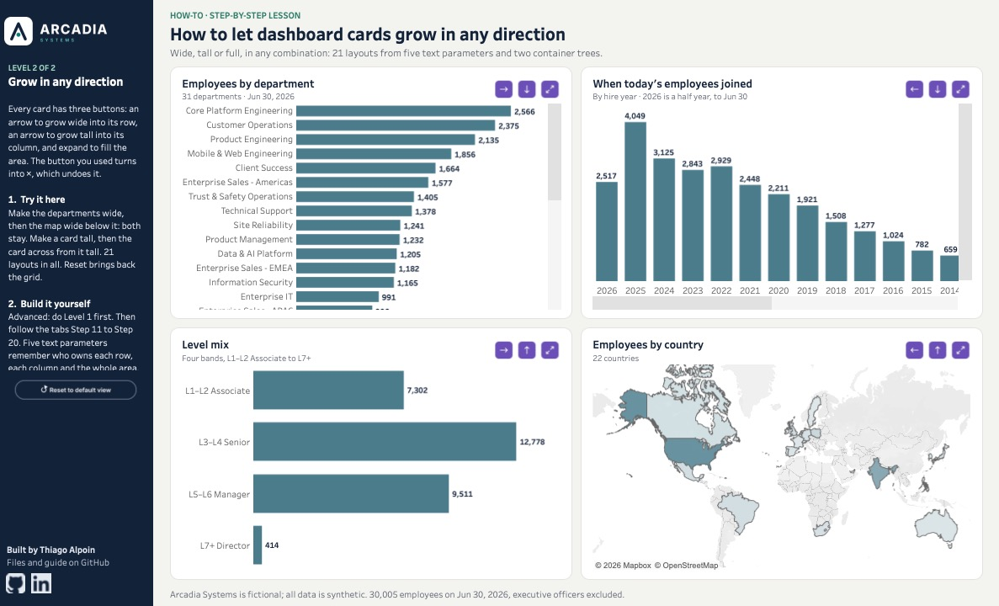

# How-To #3: card zoom, from expand-and-close to grow in any direction

Build a 2 × 2 grid of dashboard cards that zoom. In **Level 1**, each card has one button: click it and the card fills the whole area, click it again and the grid comes back. In **Level 2**, each card can also grow **wide** into its neighbor, **tall** into the card above or below, or **full**, and rows and columns combine freely: 21 layouts from four cards. Every step is a parameter, a calculation, a container or a click in Tableau. There is no SQL and no extension.

[](https://public.tableau.com/app/profile/thialp/viz/Howtomakedashboardcardsexpandandclose/Level2Growinanydirection)

**[Try it live on Tableau Public](https://public.tableau.com/app/profile/thialp/viz/Howtomakedashboardcardsexpandandclose/Level2Growinanydirection)**, or download the workbook there (the download icon under the viz) to open every step's sheet. The workbook has two dashboards, **Level 1 · Expand and close** and **Level 2 · Grow in any direction**; switch between them with the tabs under the viz.

**Who it's for.** **Level 1 is for everyone**, including people opening Tableau for the first time: section 0.5 explains the moves you'll repeat, and every step says exactly where to click. **Level 2 is advanced**: do Level 1 first, because Level 2 reuses its cards and assumes its moves.

**What you need:** Tableau Desktop or Tableau Public (the free app), version 2022.3 or later (for showing and hiding containers with a parameter). Plan on about **an hour for Level 1** (Steps 1–10) and **an hour and a half for Level 2** (Steps 11–20).

**How the lesson works.** Each step ends with something you can see or click. You build one card, **TL** (top left), all the way first: by Step 4 its button already works. Only then do the other three cards follow, from a fill-in table. The [downloadable workbook on Tableau Public](https://public.tableau.com/app/profile/thialp/viz/Howtomakedashboardcardsexpandandclose/Level2Growinanydirection) has a sheet per step, named **Step 1 · Icons** to **Step 20 · Reset and Test**; each sheet's caption (on its left) holds that step's instructions and every formula to paste. Steps that happen on a dashboard have a sheet too, so their instructions sit in a caption like the rest. Follow this page, the workbook, or both side by side.

**Credit.** Level 1 is built on Jan Kaiser's [Dynamic Zone Zooming in 7 Steps](https://www.thedataschool.de/jan-kaiser/dynamic-zone-zooming-in-7-steps/) (The Data School), from an idea by Samuel Parsons, rebuilt here on Arcadia data one card at a time. Level 2 extends it.

**What you'll learn**

| Steps | Technique | Used for |
|---|---|---|
| 1 | Custom shapes, and a "menu field" that gives a sheet one mark per value | Checking the six icons before you need them |
| 3 | Tiled containers, rows inside a column | A grid where a hidden card gives its room to the others |
| 4 | A True/False parameter, "Control visibility using value", a parameter action | TL's first working click |
| 5 | Two button sheets in one slot | A button that toggles, and never stays highlighted |
| 6 | Hiding a whole row | TL takes the whole page, not just its row |
| 7–8 | Repeating a pattern from a fill-in table | The other three cards |
| 9 | Reset, and the deselect trick | One click back to the grid |
| 12–14 | Text parameters that remember an "owner" | TL grows wide, then full |
| 15–16 | Two container trees in one space | TL grows tall |
| 17–20 | The pattern for every card, and a tour of 21 layouts | The whole Level 2 page |

Arcadia Systems is a fictional company. All data is synthetic.

---

## Contents

- [0. Get ready](#0-get-ready)
- [Part 1: the pieces](#part-1-the-pieces)
   - [Step 1: your six icons show up](#step-1-your-six-icons-show-up)
   - [Step 2: four cards that need room](#step-2-four-cards-that-need-room)
   - [Step 3: the cards sit in a 2 × 2 grid](#step-3-the-cards-sit-in-a-2--2-grid)
- [Part 2: Level 1, expand and close](#part-2-level-1-expand-and-close)
   - [Step 4: TL's button hides TR](#step-4-tls-button-hides-tr)
   - [Step 5: TL's × brings the grid back](#step-5-tls--brings-the-grid-back)
   - [Step 6: TL takes the whole page](#step-6-tl-takes-the-whole-page)
   - [Step 7: TR, BL and BR get their buttons](#step-7-tr-bl-and-br-get-their-buttons)
   - [Step 8: every card expands and closes](#step-8-every-card-expands-and-closes)
   - [Step 9: one click back to the grid](#step-9-one-click-back-to-the-grid)
   - [Step 10: the finished Level 1 page](#step-10-the-finished-level-1-page)
- [Part 3: Level 2, grow in any direction (advanced)](#part-3-level-2-grow-in-any-direction-advanced)
   - [Step 11: Level 2 starts as the same grid](#step-11-level-2-starts-as-the-same-grid)
   - [Step 12: TL gets three buttons](#step-12-tl-gets-three-buttons)
   - [Step 13: TL's arrow takes the top row](#step-13-tls-arrow-takes-the-top-row)
   - [Step 14: TL's expand takes the whole area](#step-14-tls-expand-takes-the-whole-area)
   - [Step 15: a second grid, built in columns](#step-15-a-second-grid-built-in-columns)
   - [Step 16: TL's down arrow takes the left column](#step-16-tls-down-arrow-takes-the-left-column)
   - [Step 17: the other cards' calculations](#step-17-the-other-cards-calculations)
   - [Step 18: the other cards' buttons appear](#step-18-the-other-cards-buttons-appear)
   - [Step 19: every button works](#step-19-every-button-works)
   - [Step 20: reset, and a tour of all 21 layouts](#step-20-reset-and-a-tour-of-all-21-layouts)
- [Use it on your own data](#use-it-on-your-own-data)
- [Checks](#checks)
- [Why it works this way](#why-it-works-this-way)

---

## 0. Get ready

### 0.1 Download the files

Download **[card-zoom-files.zip](https://github.com/thialp/tableau-how-to/raw/main/03-card-zoom/card-zoom-files.zip)** and unzip it (double-click it on a Mac; on Windows right-click > **Extract All**). You get:

- `arcadia_employees.csv`: one row per employee on Jun 30, 2026 (30,005 people, executive officers excluded), the same file as How-To #1;
- a folder **Arcadia How-To** with the images, including the six buttons this lesson uses.

### 0.2 Install the shapes

Tableau looks for custom shapes in one place on your computer. Move the folder **Arcadia How-To** into:

- Windows: `Documents\My Tableau Repository\Shapes\`
- Mac: `Documents/My Tableau Repository/Shapes/`

If you did How-To #1 or #2, replace the old folder: this one holds all their images plus twelve new ones, the six buttons in two colors.

| File | Size (px) | What it draws |
|---|---|---|
| `icon_expand.png` | 48 × 48 | Expand: two arrows pointing out |
| `icon_close.png` | 48 × 48 | Close: × |
| `icon_right.png` | 48 × 48 | → (Level 2: grow right) |
| `icon_left.png` | 48 × 48 | ← (Level 2: grow left) |
| `icon_up.png` | 48 × 48 | ↑ (Level 2: grow up) |
| `icon_down.png` | 48 × 48 | ↓ (Level 2: grow down) |
| `icon_expand_accent.png` … `icon_down_accent.png` | 48 × 48 | The same six in purple: the ones this lesson uses |
| `reset_button.png` | 600 × 96 | "Reset to default view" (Steps 9 and 20) |

The icons are drawn at twice their on-screen size (24 × 24), so they stay sharp on high-resolution screens.

**A note on color.** The buttons are what this lesson is about, so it uses the **purple** set (`_accent`) to make them easy to spot while you learn. On a real dashboard the quiet set (light gray, navy glyph) usually fits better: it's in the same folder, and the downloaded workbook shows it on the tab **Quiet icons**. To switch, reassign the shapes on a button sheet; nothing else changes. If Tableau was open, close it and open it again, so it sees the new folder.

### 0.3 Connect the data

1. Open Tableau. On the start page, under **Connect > To a File**, click **Text file**, and pick `arcadia_employees.csv`.
2. Tableau shows the Data Source page with a preview of the rows. At the bottom left, click **Sheet 1**.
3. **File > Save As**, and name it `Card zoom.twbx` (Tableau Public saves to your profile instead; that's fine).

**You should see** the **Data pane** on the left of Sheet 1, listing 13 fields such as `Department Name` and `Level Band`, plus `arcadia_employees.csv (Count)` at the bottom.

### 0.4 One helper field

```
// Employees
COUNT([employee_id])
```

It counts employees: one row per person, so counting the IDs counts the people. Section 0.5 shows how to create it.

### 0.5 The moves you'll repeat

**Make a calculated field.** Every formula box in this guide starts with a `//` line: that's the field's name.

1. Top menu **Analysis > Create Calculated Field**.
2. In the box at the top of the window (it says "Calculation1"), type the name from the `//` line, for example `Employees`.
3. Click in the big box below, delete anything there, and paste the formula: everything after the `//` line. (Pasting the `//` line too is harmless: Tableau treats it as a comment.)
4. Check the message at the bottom: **The calculation is valid.** If it says something else, a name is misspelled: field names in square brackets must match exactly, capitals and spaces included.
5. Click **OK**. The new field appears in the Data pane.

To change a calculation later, right-click it in the Data pane > **Edit**.

**Make a parameter.** A parameter is a value you can change on the page, like a switch or a setting.

1. In the Data pane, click the small arrow (▾) at the top right, next to the search box, and pick **Create Parameter**.
2. Type the **Name**, choose the **Data type**, set the **Current value**, and for a list of values pick **Allowable values: List** and type each value on its own line.
3. Click **OK**. Parameters show at the bottom of the Data pane, under **Parameters**.

**Put a field on a shelf or the Marks card.** Drag the field from the Data pane and drop it on the target: **Columns** and **Rows** are the long shelves at the top of the sheet; **Filters** is the box on the left; the **Marks card** below it has squares named **Color**, **Size**, **Label**, **Detail**, **Tooltip** and **Shape**. The dropdown at the top of the Marks card (it starts as **Automatic**) sets the mark type: **Bar**, **Text**, **Shape** and so on. Dropping a field on **Detail** puts it in the view without drawing anything: that's how a click can carry a value without showing it.

**Filter to one value.** Drag the field to **Filters**. A window opens with a list of the field's values: tick only the ones to keep, then **OK**. For a True/False field, keep **True** or **False**.

**Add a container on a dashboard.** On a dashboard, the left panel has an **Objects** list: **Horizontal**, **Vertical**, **Text**, **Image** and so on. Drag **Horizontal** or **Vertical** onto the dashboard to add a container: an empty box that lays out whatever you drop inside it side by side (horizontal) or one under the other (vertical). Switch the left panel to **Layout** to see the **Item hierarchy**, a tree of everything on the dashboard; that's the easiest place to select a container and to rename it (double-click its name).

**Add a parameter action.** Top menu **Dashboard > Actions**. Click **Add Action** > **Change Parameter**. A window opens: give it a name, tick the source sheets, pick what triggers it (**Select** means a click), pick the **Target Parameter** and the **Source Field** whose value it writes. Click **OK**, then **OK** again to close the list of actions.

**Show a parameter's control on the dashboard, to test.** Click a button sheet on the dashboard, open its menu (the small ▾ at its top right) > **Parameters**, and pick one: a small control appears on the dashboard, and changing it works like a click would. The list shows the parameters that sheet uses. When you're done testing, select the control and click the **×** at its top right.

---

## Part 1: the pieces

### Step 1: your six icons show up

**Why.** The buttons in this lesson are pictures, and a picture only shows if Tableau finds it in your Shapes folder. Check all six now, not in the middle of Step 4.

**Do.**

A sheet draws one mark per value of the fields in the view. No column holds "expand, close, right…", so you make one: a **menu field** that relabels six values of a column you already have. Job levels L1 to L6 are just a convenient list of six.

```
// Icon Name
CASE [job_level]
WHEN "L1" THEN "icon_expand"
WHEN "L2" THEN "icon_close"
WHEN "L3" THEN "icon_right"
WHEN "L4" THEN "icon_left"
WHEN "L5" THEN "icon_up"
WHEN "L6" THEN "icon_down"
END
```

How to read it: `CASE` looks at the job level of each row; when it's "L1" the result is "icon_expand", and so on. Levels L7 to L10 match no line, so they get no value at all, which Tableau calls **Null**.

1. Rename Sheet 1: double-click its tab at the bottom and type **Step 1 · Icons**.
2. Create the calculated field `Icon Name` (section 0.5).
3. Drag `Icon Name` to **Columns**. You get seven columns: six icon names and one called **Null**.
4. Drag `Icon Name` to **Filters**. In the list, untick **Null** and click **OK**. Six columns are left.
5. On the Marks card, change **Automatic** to **Shape**. Drag `Icon Name` from the Data pane onto the **Shape** square.
6. Click the **Shape** square. In the window, open **Select Shape Palette** and pick **Arcadia How-To**. Then, on the left, click `icon_expand` and click `icon_expand_accent` on the right (the purple one, just after the gray `icon_expand`); do the same for the other five. Click **OK**.
7. Click the **Size** square and drag the slider to about the middle.

**You should see** six purple icons in a row: expand, ×, →, ←, ↑, ↓.

**Try it.** Hover each icon: the tooltip names it. If one shows a plain circle or square instead of a picture, its file wasn't found: check the folder name and restart Tableau.

---

### Step 2: four cards that need room

**Why.** A zoom is only worth building when a card has more to say than its corner can show. These four cards each hold too much for a quarter of the page, which is the problem the rest of the lesson solves. **TL, TR, BL and BR** stand for top left, top right, bottom left and bottom right; you'll meet these letters in every name from here on.

**Do.**

The cards come ready-made in the downloadable workbook. If you're building from scratch, make them now. For the hire-year card, make one calculation first:

```
// Hire Year
YEAR([hire_date])
```

`YEAR()` takes a date and keeps only its year. Right-click `Hire Year` in the Data pane > **Convert to Discrete**, so each year becomes its own column instead of a number axis.

Make each card on a new sheet (the **New Worksheet** icon at the bottom, right of the tabs), and name the tab as in the table:

| Sheet | Rows | Columns | Mark | Sort |
|---|---|---|---|---|
| **TL · Departments** | `department_name` | `Employees` | Bar | Descending by `Employees` |
| **TR · Hire years** | `Employees` | `Hire Year` | Bar | By year |
| **BL · Level mix** | `level_band` | `Employees` | Bar | By band, L1–L2 to L7+ |
| **BR · Countries** | | | Map | |

- For the sort on TL: click the department header, then the **Sort descending** button in the toolbar (bars from longest to shortest).
- For **BR · Countries**: double-click `country_name` in the Data pane. Tableau knows these are countries and draws a map. On the Marks card pick **Map**, then drag `Employees` to **Color**: darker countries have more people.
- On every card: drag `Employees` to **Label** so each bar shows its number; right-click each axis > untick **Show Header** to hide it; **Format > Lines** > Grid Lines: **None**.
- On **TL · Departments**: **Format > Cell Size > Shorter** until each bar is about 20 px tall, so all 31 fit once the card is expanded.
- On **TR · Hire years**: **Format > Cell Size > Wider**, three or four times, so each year's column is about 40 px wide and its label reads easily.
- Tooltip (the box that appears when you hover a mark): click **Tooltip** on the Marks card and write the name in bold on the first line and "<Employees> employees" below. Untick **Include command buttons** at the bottom.

**You should see**

| Card | Shows | Check |
|---|---|---|
| TL | 31 bars | Core Platform Engineering is the largest, 2,566 |
| TR | One bar per hire year, 2001 to 2026 | 2025 is the tallest, 4,049. 2001 holds the founding group (197). 2026 is a half year: 2,517 up to Jun 30 |
| BL | 4 bars | L3–L4 Senior 12,778, L5–L6 Manager 9,511, L1–L2 Associate 7,302, L7+ 414 |
| BR | 22 countries | United States 9,362, India 6,967 |

TR counts **today's** employees by the year they joined, not everyone ever hired: people who joined in 2005 and left are not in the file.

**Try it.** On **TR · Hire years**, look at the bottom of the sheet: 26 columns at 40 px don't fit across, so there's a scroll bar. Hold that thought until Step 3.

---

### Step 3: the cards sit in a 2 × 2 grid

**Why.** Zooming works by hiding things, and hiding only gives room away in a **tiled** container: when one item hides, the items next to it grow. So the grid is built as containers inside containers: a column holding two rows, each row holding two cards.

**Do.** One container per line; rename each one as you add it (Layout tab > Item hierarchy > double-click its name). Leave everything **tiled** (the default; the **Tiled / Floating** switch sits under the Objects list).

1. Create a dashboard: the **New Dashboard** icon at the bottom (the second of the three icons right of the tabs). Name its tab **Level 1 · Expand and close**. On the left, under **Size**, pick **Fixed size** and type 1400 × 850.
2. Drag a **Vertical** container onto the empty dashboard. Name it **Cards**.
3. Drag a **Horizontal** container into Cards. Name it **Top Row**.
4. Drag a second **Horizontal** container into Cards, below Top Row (a dark line shows where it will land). Name it **Bottom Row**.
5. Drag a **Vertical** container into Top Row. Name it **TL Card**.
6. Drag a **Vertical** container into Top Row, to the right of TL Card. Name it **TR Card**.
7. Drag a **Vertical** container into Bottom Row. Name it **BL Card**.
8. Drag a **Vertical** container into Bottom Row, to the right of BL Card. Name it **BR Card**.
9. Drag a **Horizontal** container into TL Card. Name it **TL Title Row**. In the Layout tab, under **Size**, set its **Height** to 40 and tick **Fixed**.
10. Drag a **Text** object into TL Title Row and type the card's title: "Employees by department".
11. Drag the sheet **TL · Departments** from the Sheets list into TL Card, below TL Title Row. Open its menu (the small ▾ at its top right) > **Hide Title**.
12. Do lines 9 to 11 for the other three cards:

    | Card container | Title row | Title | Sheet |
    |---|---|---|---|
    | TR Card | TR Title Row | When today's employees joined | TR · Hire years |
    | BL Card | BL Title Row | Level mix | BL · Level mix |
    | BR Card | BR Title Row | Employees by country | BR · Countries |

13. Fit each chart to its card, from the sheet's menu (▾) > **Fit** on the dashboard: **TL · Departments** > **Fit Width**; **TR · Hire years** > **Fit Height**; the other two > **Entire View**.
14. Select **Cards**, open its menu (▾) > **Distribute Contents Evenly**. Do the same on **Top Row** and **Bottom Row**, so the grid splits into equal halves. Leave it off on the card containers and title rows: their items are sized by hand.

**You should see** the four cards in a 2 × 2 grid, each with its title. Check your Item hierarchy against this one:

```text
Level 1 · Expand and close
└─ Cards (Vertical)
   ├─ Top Row (Horizontal)
   │  ├─ TL Card (Vertical)
   │  │  ├─ TL Title Row (Horizontal, height 40, fixed)
   │  │  │  └─ Text: Employees by department
   │  │  └─ TL · Departments
   │  └─ TR Card (Vertical)
   │     ├─ TR Title Row
   │     └─ TR · Hire years
   └─ Bottom Row (Horizontal)
      ├─ BL Card (Vertical)
      │  ├─ BL Title Row
      │  └─ BL · Level mix
      └─ BR Card (Vertical)
         ├─ BR Title Row
         └─ BR · Countries
```

**Try it.** Scroll TL: only about half of its 31 departments fit at a time. Scroll TR sideways: only some of the years fit. This is the problem the lesson solves: the data is all there, but a corner is too small to read it. When TL expands in Step 6, the scroll bar goes away.

---

## Part 2: Level 1, expand and close

The goal: each card gets one button in its title row. In the grid it shows **expand**. Click it, and the other cards disappear so the card fills the area, and the button turns into **×**. Click × and the grid comes back. You'll make it work on **TL** first, all the way, then copy the pattern to TR, BL and BR.

### Step 4: TL's button hides TR

**Why.** A dashboard container can be shown or hidden by a True/False parameter, and a click can change a parameter. Put the two together and a click hides a card.

**Do.**

1. Create a parameter (section 0.5): **Name** `Show TR`, **Data type** Boolean (Tableau's word for True/False), **Current value** True. It means "show the top-right card".
2. Create two calculated fields. `NOT` flips True into False and False into True.

```
// TL Button Filter
[Show TR]
```

```
// TL Button Switch
NOT [Show TR]
```

   The **Filter** says what TL's button should look like: True means "TR is showing", so show expand. The **Switch** is what a click should write: in the grid it's False, so a click hides TR.

3. New worksheet, named **TL Open** (in the downloaded workbook its tab reads **Step 4 · TL Open**).
4. Marks card: change **Automatic** to **Shape**. Drag `TL Button Filter` onto the **Shape** square.
5. Click **Shape** > **Select Shape Palette: Arcadia How-To**. Click **True** on the left and pick `icon_expand_accent`; click **False** and pick `icon_close_accent`. **OK**.
6. Drag `TL Button Switch` onto the **Detail** square. Nothing changes on screen: Detail only carries the value the click will write.
7. Click **Size** and set it small, about a quarter of the slider. Click **Tooltip**, type "Expand this card", untick **Include command buttons**, **OK**.
8. On the dashboard, drag **TL Open** into **TL Title Row**, to the right of the title text. Select it, and in the Layout tab set its **Width** to 32, **Fixed**. Hide its title.
9. Select **TR Card** in the Item hierarchy. In the Layout tab, under **Visibility**, tick **Control visibility using value**, then pick **Parameters > Show TR**.
10. **Dashboard > Actions > Add Action > Change Parameter**:

    | Name | Source sheets | Run action on | Target parameter | Source field | Aggregation | Clearing the selection will |
    |---|---|---|---|---|---|---|
    | TL → Show TR | TL Open only | Select | Show TR | TL Button Switch | None | Keep current value |

    (The source field may show as ATTR(TL Button Switch); that's fine, the sheet has one mark.)

**You should see** TL with an expand icon at its top right.

**Try it.** Click the expand icon. TR disappears and TL takes the whole top row, and its icon turns into ×. Now click the ×. Nothing happens: the × is still **selected** from your first click, and a click on a selected mark only unselects it. Click once more and the grid comes back. Step 5 fixes the extra click.

---

### Step 5: TL's × brings the grid back

**Why.** A selected mark swallows the next click. The fix is two sheets in one slot: an **Open** sheet that has its mark only in the grid, and a **Close** sheet that has its mark only when TL is zoomed. The sheet you click goes empty at once, so nothing is left selected.

**Do.**

1. On **TL Open**, drag `TL Button Filter` to **Filters**, keep **True** only, **OK**.
2. Right-click the **TL Open** tab > **Duplicate**. Rename the copy **TL Close** (its tab in the downloaded workbook reads **Step 5 · TL Close**).
3. On **TL Close**, click the arrow on the `TL Button Filter` pill in Filters > **Edit Filter**, untick True, tick **False**, **OK**. The shape follows by itself: False is ×. Change its tooltip to "Back to the grid".
4. On the dashboard, drag **TL Close** into **TL Title Row**, to the right of TL Open. Width 32, **Fixed**, hide its title.
5. **Dashboard > Actions**, select **TL → Show TR** > **Edit**. Under **Source Sheets**, tick **TL Close** too, so both button sheets run it. **OK**.

**You should see** the expand icon at TL's top right and an empty slot beside it: TL Close has no mark in the grid.

**Try it.** Click expand, then ×, then expand again: one click each, every time. Then look at TL while it's expanded: it has TR's width, but the bottom row is still there, so TL is only half as tall as the page. Step 6 fixes that.

---

### Step 6: TL takes the whole page

**Why.** Hiding TR gave TL its width; the height belongs to the bottom row. Hiding **BL and BR** wouldn't help: the empty row would keep its height. Hiding the **row itself** gives TL the full page, and takes BL and BR with it.

**Do.**

1. Create a parameter: `Show Bottom Row`, Boolean, current value True.
2. Edit the two calculations (right-click > **Edit**) so they read both switches. `AND` means "both are true".

```
// TL Button Filter
[Show TR] AND [Show Bottom Row]
```

```
// TL Button Switch
NOT [Show TR] AND NOT [Show Bottom Row]
```

3. Select **Bottom Row** in the Item hierarchy. Tick **Control visibility using value** > **Parameters > Show Bottom Row**.
4. **Dashboard > Actions > Add Action > Change Parameter**:

    | Name | Source sheets | Run action on | Target parameter | Source field | Clearing the selection will |
    |---|---|---|---|---|---|
    | TL → Show Bottom Row | TL Open, TL Close | Select | Show Bottom Row | TL Button Switch | Keep current value |

**You should see** TL's expand still in the grid, and nothing else changed yet.

**Try it.** Click TL's expand: TL fills the whole area, and its scroll bar is gone: all 31 departments fit. Click ×: the grid is back. Then test with the switches directly: click **TL Open** on the dashboard, its menu (▾) > **Parameters > Show Bottom Row**. In the control, pick **False**: the bottom row disappears and TL and TR share the whole height. Pick **True** again, then remove the control (select it > ×).

TL now works end to end: two switches, two calculations, two button sheets, two containers with visibility, two actions. The other three cards are the same pattern.

---

### Step 7: TR, BL and BR get their buttons

**Why.** Each card hides its row neighbor and the **other** row. A top card hides the bottom row; a bottom card hides the top row.

**Do.**

1. Create four more Boolean parameters, current value True: `Show TL`, `Show BL`, `Show BR`, `Show Top Row`.
2. Create six calculated fields, two per card, following TL's pattern:

    | Card | Hides | Button Filter | Button Switch |
    |---|---|---|---|
    | TR | TL and the bottom row | `[Show TL] AND [Show Bottom Row]` | `NOT [Show TL] AND NOT [Show Bottom Row]` |
    | BL | BR and the top row | `[Show BR] AND [Show Top Row]` | `NOT [Show BR] AND NOT [Show Top Row]` |
    | BR | BL and the top row | `[Show BL] AND [Show Top Row]` | `NOT [Show BL] AND NOT [Show Top Row]` |

```
// TR Button Filter
[Show TL] AND [Show Bottom Row]
```

```
// TR Button Switch
NOT [Show TL] AND NOT [Show Bottom Row]
```

```
// BL Button Filter
[Show BR] AND [Show Top Row]
```

```
// BL Button Switch
NOT [Show BR] AND NOT [Show Top Row]
```

```
// BR Button Filter
[Show BL] AND [Show Top Row]
```

```
// BR Button Switch
NOT [Show BL] AND NOT [Show Top Row]
```

3. Right-click the **TL Open** tab > **Duplicate**, and rename the copy **TR Open**.
4. On TR Open, drag `TR Button Filter` from the Data pane and drop it **exactly on top of** the `TL Button Filter` pill in Filters (Tableau replaces it and asks which values to keep: **True**). Drop it on top of the pill on Shape too, and assign True = `icon_expand_accent`, False = `icon_close_accent`. Drop `TR Button Switch` on top of `TL Button Switch` on Detail.
5. Duplicate **TR Open** and rename it **TR Close**; edit its filter to keep **False**.
6. Repeat 3 to 5 for BL (**BL Open**, **BL Close**) and BR (**BR Open**, **BR Close**).
7. On the dashboard, put each card's Open and Close sheets in its title row, right of the title, 32 wide, fixed, titles hidden.

**You should see** an expand icon at the top right of all four cards, with an empty slot beside each.

**Try it.** Click TR's expand. Nothing happens: TR's button has no action yet. That's Step 8.

---

### Step 8: every card expands and closes

**Why.** Same as TL: each card's containers get their switch, and each card's two button sheets get two actions.

**Do.**

1. Control visibility, one container per line (select it in the Item hierarchy > **Control visibility using value** > **Parameters**):
   - **TL Card**: `Show TL`
   - **BL Card**: `Show BL`
   - **BR Card**: `Show BR`
   - **Top Row**: `Show Top Row`
2. Six actions (**Dashboard > Actions > Add Action > Change Parameter**), all on **Select**, aggregation None, **Keep current value**:

    | Name | Source sheets | Target parameter | Source field |
    |---|---|---|---|
    | TR → Show TL | TR Open, TR Close | Show TL | TR Button Switch |
    | TR → Show Bottom Row | TR Open, TR Close | Show Bottom Row | TR Button Switch |
    | BL → Show BR | BL Open, BL Close | Show BR | BL Button Switch |
    | BL → Show Top Row | BL Open, BL Close | Show Top Row | BL Button Switch |
    | BR → Show BL | BR Open, BR Close | Show BL | BR Button Switch |
    | BR → Show Top Row | BR Open, BR Close | Show Top Row | BR Button Switch |

**You should see** the grid, unchanged.

**Try it.** Expand each card and close it: TR fills the area with ×, and so do BL and BR. Then expand BR and look for TL's button: it's hidden along with TL. Once a card is zoomed, × is the only way back. Step 9 adds a second one.

---

### Step 9: one click back to the grid

**Why.** A dashboard opens in whatever state it was saved in: save it with BR zoomed, and every visitor starts zoomed. A Reset button writes True into all six switches, so the grid is one click away; click it before you save.

**Do.**

1. Create four calculated fields:

```
// Reset True
TRUE
```

```
// Reset Shape
"reset_button"
```

```
// zzTrue
TRUE
```

```
// zzFalse
FALSE
```

2. New worksheet **L1 Reset** (tab **Step 9 · Reset** in the downloaded workbook). Marks card **Shape**; drag `Reset Shape` to **Shape**, palette **Arcadia How-To**, assign `reset_button`.
3. Drag `Reset True`, `zzTrue` and `zzFalse` to **Detail**. **Size**: large enough to fill the slot. Tooltip "Back to the grid", command buttons off.
4. Put **L1 Reset** on the dashboard, 200 × 32 (on the finished page it sits in the rail on the left).
5. Six actions from **L1 Reset** only, on **Select**, source field `Reset True`, **Keep current value**, one per target: `Show TL`, `Show TR`, `Show BL`, `Show BR`, `Show Top Row`, `Show Bottom Row`.
6. The **deselect trick**. Unlike the card buttons, the Reset sheet keeps its mark after a click, so the mark would stay selected. **Dashboard > Actions > Add Action > Filter**:
   - **Source Sheets:** L1 Reset only; **Run action on:** Select
   - **Target Sheets:** L1 Reset only
   - **Clearing the selection will:** Show all values
   - **Filter:** Selected Fields, then the field pair **zzTrue** (source) → **zzFalse** (target)

   On every click it asks Tableau for rows where TRUE equals FALSE. There are none, so the selection drops at once, and because the action clears to "Show all values", nothing on the sheet disappears.

**You should see** the Reset button on the dashboard.

**Try it.**

| Do | The dashboard |
|---|---|
| Click TL's expand, then Reset | TL alone, then the grid |
| Click BR's expand, then Reset, then Reset again | BR alone, the grid, and the second click still works: nothing stays highlighted |

Click Reset before you save.

---

### Step 10: the finished Level 1 page

**Why.** The page explains itself before anyone clicks: a title that says what it is, a rail with the instructions and Reset, and a footnote about the data.

**Do.** Optional polish, same frame as How-To #1 and #2. Every item outside the card grid is **floating**.

| Item | x | y | w | h | Notes |
|---|---:|---:|---:|---:|---|
| Rail (Blank object) | 0 | 0 | 216 | 850 | Navy `#13233A` |
| Logo (Image) | 8 | 24 | 160 | 40 | `arcadia_logo_reverse.png` |
| Rail text | 8 | 88 | 200 | 430 | What the page is, then Try it here / Build it yourself / Use your own data |
| L1 Reset | 8 | 530 | 200 | 32 | |
| Title (Text) | 240 | 8 | 1136 | 80 | "How to make dashboard cards expand and close" |
| Cards | 234 | 88 | 1148 | 730 | Each card container: white, border 1 px `#E4E3DD`, outer padding 6, inner padding 12 |
| Footnote (Text) | 240 | 822 | 1136 | 18 | "Arcadia Systems is fictional; all data is synthetic." |

**You should see** the finished Level 1 page, as in the downloaded workbook's first dashboard.

**Try it.** Click Reset, then save. Level 1 is done.

---

## Part 3: Level 2, grow in any direction (advanced)

**Do Level 1 first.** Level 2 reuses its four cards, and assumes you've already added containers, visibility and parameter actions. Plan on an hour and a half.

In Level 1 a card has one move: take the whole area. In Level 2 every card has three:

- **wide** (→ or ←): take the whole row, pushing its neighbor out;
- **tall** (↓ or ↑): take the whole column, pushing the card above or below out;
- **full** (expand): take the whole area.

The button for the move in force turns into ×, which undoes it. Moves combine: TL can be wide while BR is wide too, or TL tall while TR is tall. With the grid, that's 21 layouts. As in Level 1, you'll make **TL** work first, one move at a time.

### Step 11: Level 2 starts as the same grid

**Why.** Every Level 2 move starts from the grid you already know, so the new dashboard begins with the same rows and cards. A sheet can sit on several dashboards, so Level 1's four card sheets are reused here.

**Do.** One container per line, all tiled; rename each as you add it.

1. New dashboard, tab **Level 2 · Grow in any direction**, Fixed size 1400 × 850.
2. Drag a **Vertical** container onto it. Name it **Area**.
3. Drag a **Vertical** container into Area. Name it **Rows Tree**.
4. Drag a **Horizontal** container into Rows Tree. Name it **Top Row 2**.
5. Drag a **Horizontal** container into Rows Tree, below Top Row 2. Name it **Bottom Row 2**.
6. Drag a **Vertical** container into Top Row 2. Name it **TL Card 2**.
7. Drag a **Vertical** container into Top Row 2, right of TL Card 2. Name it **TR Card 2**.
8. Drag a **Vertical** container into Bottom Row 2. Name it **BL Card 2**.
9. Drag a **Vertical** container into Bottom Row 2, right of BL Card 2. Name it **BR Card 2**.
10. In each card container: a **Horizontal** title row (height 40, fixed) named **TL Title Row 2** and so on, with the title text inside it; then the card's sheet below it, title hidden. The same four titles and sheets as Step 3, with the same fit: TL Fit Width, TR Fit Height.
11. **Distribute Contents Evenly** on Area, Rows Tree, Top Row 2 and Bottom Row 2.

**You should see** the same 2 × 2 grid as Level 1, without buttons. Check your Item hierarchy:

```text
Level 2 · Grow in any direction
└─ Area (Vertical)
   └─ Rows Tree (Vertical)
      ├─ Top Row 2 (Horizontal)
      │  ├─ TL Card 2  (TL Title Row 2, TL · Departments)
      │  └─ TR Card 2  (TR Title Row 2, TR · Hire years)
      └─ Bottom Row 2 (Horizontal)
         ├─ BL Card 2  (BL Title Row 2, BL · Level mix)
         └─ BR Card 2  (BR Title Row 2, BR · Countries)
```

**Try it.** Switch to the Level 1 dashboard tab and back: the same four sheets show on both. Changing a card sheet changes it in both places.

---

### Step 12: TL gets three buttons

**Why.** Level 1's switches answered "is this card showing?". Level 2 asks a different question, one per row and per column: **who owns it?** An **owner** is the card that has a row (or a column, or the whole area) to itself. For example, the top row's owner is **both** in the grid, **TL** when TL is wide, and **TR** when TR is wide. Store the owner, and what's visible follows from it.

**Do.**

1. Create one parameter first, to see the idea: **Name** `p_Top`, **Data type** String, **Allowable values: List**, values `both`, `TL`, `TR` (each on its own line), **Current value** both.
2. The same for the bottom row, the two columns and the whole area. Full uses **none** instead of both:

    | Parameter | Values (current value first) | Who owns |
    |---|---|---|
    | `p_Top` | both, TL, TR | the top row |
    | `p_Bottom` | both, BL, BR | the bottom row |
    | `p_Left` | both, TL, BL | the left column |
    | `p_Right` | both, TR, BR | the right column |
    | `p_Full` | none, TL, TR, BL, BR | the whole area |

3. Each button sheet needs three marks, one per move. No column holds "wide, tall, full", so a menu field makes one, as in Step 1:

```
// Kind
CASE [level_band]
WHEN "L1–L2 Associate" THEN "wide"
WHEN "L3–L4 Senior" THEN "tall"
WHEN "L5–L6 Manager" THEN "full"
END
```

(The band names use an en dash, "–", not a hyphen: copy them from here.)

```
// Kind No
CASE [Kind] WHEN "wide" THEN 1 WHEN "tall" THEN 2 WHEN "full" THEN 3 END
```

`Kind No` puts the three buttons in a fixed order, left to right.

4. TL's icon on each mark: × when that move is already in force, otherwise its arrow.

```
// TL Icon
IF [Kind] = "wide" THEN IIF([p_Top] = "TL", "icon_close", "icon_right")
ELSEIF [Kind] = "tall" THEN IIF([p_Left] = "TL", "icon_close", "icon_down")
ELSE IIF([p_Full] = "TL", "icon_close", "icon_expand") END
```

How to read it: `IIF(test, a, b)` gives a when the test is true, b when it's false. On the wide mark: × if TL owns the top row, otherwise →. On the tall mark: × if TL owns the left column, otherwise ↓. On the full mark: × if TL owns the area, otherwise expand.

```
// Kind Tip
CASE [Kind]
WHEN "wide" THEN "Grow wide: take the whole row"
WHEN "tall" THEN "Grow tall: take the whole column"
ELSE "Full: take the whole area"
END
```

5. New worksheet **TL Buttons** (tab **Step 12 · TL Buttons** in the downloaded workbook).
6. Drag `Kind` to **Filters**, untick **Null**, **OK**: three values left.
7. Drag `Kind No` to **Columns**. Right-click it > **Convert to Discrete** if it shows as an axis. Right-click its header > untick **Show Header**.
8. Marks card **Shape**. Drag `TL Icon` to **Shape**; click Shape, palette **Arcadia How-To**, and assign each value to the purple picture with the same name (`icon_right` → `icon_right_accent`, and so on).
9. Drag `Kind`, `zzTrue` and `zzFalse` to **Detail**. Tooltip: `<Kind Tip>` on the first line (use **Insert** in the tooltip editor), "Click again to undo." on the second; command buttons off. **Size**: small.
10. On the Level 2 dashboard, drag **TL Buttons** into **TL Title Row 2**, right of the title: width 96, fixed, title hidden.

**You should see** three purple icons at TL's top right: →, ↓ and expand.

**Try it.** Click **TL Buttons** on the dashboard, its menu (▾) > **Parameters > p_Top**. Set it to **TL**: the → turns into ×, but nothing moves yet; no container listens to the owners. Set it back to **both** and remove the control.

---

### Step 13: TL's arrow takes the top row

**Why.** TR should hide when TL owns the top row. That's a calculation on the owners, and a calculation that reads only parameters can drive **Control visibility using value**, just like a parameter. Then TL's → needs an action that writes TL into `p_Top`.

**Do.**

1. Two visibility calculations. `=` means "equals", `OR` means "either one is true". (Each also watches `p_Full`, which Step 14 uses.)

```
// L2 TL
NOT ([p_Top] = "TR" OR [p_Full] = "TR")
```

```
// L2 TR
NOT ([p_Top] = "TL" OR [p_Full] = "TL")
```

2. Select **TL Card 2** > **Control visibility using value** > this time open the data source's name (not Parameters) and pick `L2 TL`. Select **TR Card 2** > `L2 TR`.
3. What TL's click writes into `p_Top`, depending on which of its three marks was clicked: the → claims the top row, or gives it back if TL already has it; the other two moves give it back.

```
// TL to Top
IF [Kind] = "wide" THEN IIF([p_Top] = "TL", "both", "TL") ELSE "both" END
```

4. Drag `TL to Top` to **Detail** on **TL Buttons**.
5. **Dashboard > Actions > Add Action > Change Parameter**: name **TL to Top**, source **TL Buttons** only, Select, target `p_Top`, source field `TL to Top`, Keep current value.
6. The deselect trick (Step 9): **Add Action > Filter**, source and target **TL Buttons**, Select, Show all values, Selected Fields zzTrue → zzFalse. TL Buttons keeps its marks after a click, so it needs one.

**You should see** the grid, and TL's three buttons.

**Try it.** Click TL's →: TR disappears, TL takes the top row, and the → turns into ×. Click ×: the grid is back. Click ↓ or expand: nothing yet.

---

### Step 14: TL's expand takes the whole area

**Why.** Full is Level 1's move again, written as an owner: when `p_Full` is TL, the bottom row hides (TR already watches `p_Full`). The same calculations cover all four cards going full, so make them all now.

**Do.**

1. The rows, and the two bottom cards: a row hides when a card in the other row goes full, and a bottom card hides when its neighbor owns the bottom row or goes full.

```
// L2 Top Row
[p_Full] = "none" OR [p_Full] = "TL" OR [p_Full] = "TR"
```

```
// L2 Bottom Row
[p_Full] = "none" OR [p_Full] = "BL" OR [p_Full] = "BR"
```

```
// L2 BL
NOT ([p_Bottom] = "BR" OR [p_Full] = "BR")
```

```
// L2 BR
NOT ([p_Bottom] = "BL" OR [p_Full] = "BL")
```

2. Control visibility using value, one container per line:
   - **Top Row 2**: `L2 Top Row`
   - **Bottom Row 2**: `L2 Bottom Row`
   - **BL Card 2**: `L2 BL`
   - **BR Card 2**: `L2 BR`
3. What TL's click writes into `p_Full`:

```
// TL to Full
IF [Kind] = "full" THEN IIF([p_Full] = "TL", "none", "TL") ELSE "none" END
```

4. Drag `TL to Full` to **Detail** on TL Buttons. Add the action **TL to Full**: source TL Buttons, target `p_Full`, source field `TL to Full`, Keep current value.

**You should see** the grid.

**Try it.** Click TL's expand: TL fills the area. Click →: TL goes straight from full to wide, because the → writes "none" into `p_Full` and TL into `p_Top` in the same click. Click × to get the grid back.

---

### Step 15: a second grid, built in columns

**Why.** Click TL's ↓ now: nothing can happen, and not only because there's no action yet. In the rows tree, TL and BL sit in different rows, and a container can only hand space to its own children; no row can reach into the other. To grow tall, the cards must sit in **columns**: a row of two columns, each holding two cards. So Level 2 builds a second tree in the same space, the **columns tree**, and Step 16 shows one tree at a time.

**Do.**

1. A sheet can sit on a dashboard only once, so the columns tree needs its own copies. Right-click each card tab > **Duplicate**, and rename the copies **TL · Departments (col)**, **TR · Hire years (col)**, **BL · Level mix (col)**, **BR · Countries (col)**.
2. Right-click **TL Buttons** > **Duplicate**; rename it **TL Buttons (col)**.
3. Drag a **Horizontal** container into **Area**, below Rows Tree. Name it **Columns Tree**.
4. Drag a **Vertical** container into Columns Tree. Name it **Left Col**.
5. Drag a **Vertical** container into Columns Tree, right of Left Col. Name it **Right Col**.
6. Drag a **Vertical** container into Left Col. Name it **TL Card (col)**.
7. Drag a **Vertical** container into Left Col, below TL Card (col). Name it **BL Card (col)**.
8. Drag a **Vertical** container into Right Col. Name it **TR Card (col)**.
9. Drag a **Vertical** container into Right Col, below TR Card (col). Name it **BR Card (col)**.
10. In each: a title row (height 40, fixed) named **TL Title Row (col)** and so on, with the title text, then the `(col)` card sheet below it. Put **TL Buttons (col)** in TL Title Row (col), width 96, fixed.
11. **Distribute Contents Evenly** on Columns Tree, Left Col and Right Col.

**You should see** two grids, one above the other, each half as tall: the top one built in rows, the bottom one in columns. Check your Item hierarchy:

```text
Level 2 · Grow in any direction
└─ Area (Vertical)
   ├─ Rows Tree (Vertical)
   │  ├─ Top Row 2: TL Card 2, TR Card 2
   │  └─ Bottom Row 2: BL Card 2, BR Card 2
   └─ Columns Tree (Horizontal)
      ├─ Left Col (Vertical)
      │  ├─ TL Card (col)  (TL Title Row (col) with TL Buttons (col), TL · Departments (col))
      │  └─ BL Card (col)  (BL Title Row (col), BL · Level mix (col))
      └─ Right Col (Vertical)
         ├─ TR Card (col)  (TR Title Row (col), TR · Hire years (col))
         └─ BR Card (col)  (BR Title Row (col), BR · Countries (col))
```

**Try it.** Click TL's → in the **top** grid: TL goes wide there, and the bottom grid doesn't move. Its containers don't listen to the owners yet. Click × to undo.

---

### Step 16: TL's down arrow takes the left column

**Why.** Exactly one tree should show: the rows tree, unless a column has an owner. Inside the columns tree, a card hides when the card above or below owns its column. And TL's click must now write all five owners, because a move in one direction clears the other: going tall while you were wide gives the row back.

**Do.**

1. Which tree shows. The two are exact opposites, so one is always on:

```
// L2 Rows Tree
[p_Left] = "both" AND [p_Right] = "both"
```

```
// L2 Columns Tree
NOT ([p_Left] = "both" AND [p_Right] = "both")
```

2. The four cards of the columns tree. `<>` means "is not":

```
// L2 TL (col)
[p_Left] <> "BL"
```

```
// L2 BL (col)
[p_Left] <> "TL"
```

```
// L2 TR (col)
[p_Right] <> "BR"
```

```
// L2 BR (col)
[p_Right] <> "TR"
```

3. Control visibility using value, one container per line:
   - **Rows Tree**: `L2 Rows Tree`
   - **Columns Tree**: `L2 Columns Tree`
   - **TL Card (col)**: `L2 TL (col)`
   - **BL Card (col)**: `L2 BL (col)`
   - **TR Card (col)**: `L2 TR (col)`
   - **BR Card (col)**: `L2 BR (col)`
4. TL's three remaining writes. A wide click leaves the **other** row as it is, and a tall click leaves the **other** column as it is: that's what lets two moves stand side by side later.

```
// TL to Bottom
IF [Kind] = "wide" THEN [p_Bottom] ELSE "both" END
```

```
// TL to Left
IF [Kind] = "tall" THEN IIF([p_Left] = "TL", "both", "TL") ELSE "both" END
```

```
// TL to Right
IF [Kind] = "tall" THEN [p_Right] ELSE "both" END
```

5. Drag the three to **Detail** on **TL Buttons**, and on **TL Buttons (col)** (which already has the other two).
6. On **TL Buttons**, add three actions: **TL to Bottom** (target `p_Bottom`), **TL to Left** (`p_Left`), **TL to Right** (`p_Right`), each from its own source field, Keep current value.
7. On **TL Buttons (col)**, all five, with that sheet as the only source: TL (col) to Top, to Bottom, to Left, to Right, to Full. Plus its deselect (source and target TL Buttons (col), zzTrue → zzFalse).

**You should see** one grid again: the columns tree hides while no column has an owner.

**Try it.**

| Click | The dashboard |
|---|---|
| TL's ↓ | The columns tree: TL takes the left column, TR and BR on the right |
| TL's × | The grid |
| TL's ↓, then TL's → | Wide clears tall: back to rows, TL takes the top row |
| TL's expand, then × | TL alone, then the grid |

TL now has all three moves. The other three cards are the same pattern.

---

### Step 17: the other cards' calculations

**Why.** Each card claims its **own** row and its **own** column, and leaves the other row and column as they are. Only the names change from TL's.

**Do.** Create the three icons and the fifteen source calculations. The pattern, card by card:

| Card | Its row | Other row | Its column | Other column | Wide arrow | Tall arrow |
|---|---|---|---|---|---|---|
| TL | `p_Top` | `p_Bottom` | `p_Left` | `p_Right` | → | ↓ |
| TR | `p_Top` | `p_Bottom` | `p_Right` | `p_Left` | ← | ↓ |
| BL | `p_Bottom` | `p_Top` | `p_Left` | `p_Right` | → | ↑ |
| BR | `p_Bottom` | `p_Top` | `p_Right` | `p_Left` | ← | ↑ |

```
// TR Icon
IF [Kind] = "wide" THEN IIF([p_Top] = "TR", "icon_close", "icon_left")
ELSEIF [Kind] = "tall" THEN IIF([p_Right] = "TR", "icon_close", "icon_down")
ELSE IIF([p_Full] = "TR", "icon_close", "icon_expand") END
```

```
// BL Icon
IF [Kind] = "wide" THEN IIF([p_Bottom] = "BL", "icon_close", "icon_right")
ELSEIF [Kind] = "tall" THEN IIF([p_Left] = "BL", "icon_close", "icon_up")
ELSE IIF([p_Full] = "BL", "icon_close", "icon_expand") END
```

```
// BR Icon
IF [Kind] = "wide" THEN IIF([p_Bottom] = "BR", "icon_close", "icon_left")
ELSEIF [Kind] = "tall" THEN IIF([p_Right] = "BR", "icon_close", "icon_up")
ELSE IIF([p_Full] = "BR", "icon_close", "icon_expand") END
```

```
// TR to Top
IF [Kind] = "wide" THEN IIF([p_Top] = "TR", "both", "TR") ELSE "both" END
```

```
// TR to Bottom
IF [Kind] = "wide" THEN [p_Bottom] ELSE "both" END
```

```
// TR to Right
IF [Kind] = "tall" THEN IIF([p_Right] = "TR", "both", "TR") ELSE "both" END
```

```
// TR to Left
IF [Kind] = "tall" THEN [p_Left] ELSE "both" END
```

```
// TR to Full
IF [Kind] = "full" THEN IIF([p_Full] = "TR", "none", "TR") ELSE "none" END
```

```
// BL to Bottom
IF [Kind] = "wide" THEN IIF([p_Bottom] = "BL", "both", "BL") ELSE "both" END
```

```
// BL to Top
IF [Kind] = "wide" THEN [p_Top] ELSE "both" END
```

```
// BL to Left
IF [Kind] = "tall" THEN IIF([p_Left] = "BL", "both", "BL") ELSE "both" END
```

```
// BL to Right
IF [Kind] = "tall" THEN [p_Right] ELSE "both" END
```

```
// BL to Full
IF [Kind] = "full" THEN IIF([p_Full] = "BL", "none", "BL") ELSE "none" END
```

```
// BR to Bottom
IF [Kind] = "wide" THEN IIF([p_Bottom] = "BR", "both", "BR") ELSE "both" END
```

```
// BR to Top
IF [Kind] = "wide" THEN [p_Top] ELSE "both" END
```

```
// BR to Right
IF [Kind] = "tall" THEN IIF([p_Right] = "BR", "both", "BR") ELSE "both" END
```

```
// BR to Left
IF [Kind] = "tall" THEN [p_Left] ELSE "both" END
```

```
// BR to Full
IF [Kind] = "full" THEN IIF([p_Full] = "BR", "none", "BR") ELSE "none" END
```

**You should see** "The calculation is valid." under each one, and 18 new fields in the Data pane.

**Try it.** Open **TR to Top** and **BR to Bottom** side by side: the same formula, with the card's own row and name swapped in.

---

### Step 18: the other cards' buttons appear

**Why.** Each card needs a button sheet in each tree. TL has both already, so six more sheets: TR, BL and BR in the rows tree, and the same three in the columns tree. They're copies of TL's with the card's own fields swapped in.

**Do.**

1. Duplicate **TL Buttons** and rename it **TR Buttons**. Drop `TR Icon` exactly on top of `TL Icon` on Shape, and assign its pictures. On Detail, drop each TR source calculation on top of its TL twin (TR to Top on TL to Top, and so on).
2. Do the same for **BL Buttons** and **BR Buttons**.
3. Duplicate **TR Buttons**, **BL Buttons** and **BR Buttons** once more and add " (col)" to each name.
4. Put each sheet in its card's title row, width 96, fixed, title hidden: the plain ones in **TR Title Row 2**, **BL Title Row 2**, **BR Title Row 2**; the "(col)" ones in the matching **(col)** title rows.

**You should see** three icons on every card. In the rows tree: TR shows ←, ↓, expand; BL shows →, ↑, expand; BR shows ←, ↑, expand.

**Try it.** Click **TR Buttons** on the dashboard, its menu (▾) > **Parameters > p_Top**, and set it to **TR**: TR's ← turns into ×, TL hides and TR takes the top row. Set it back to **both** and remove the control.

---

### Step 19: every button works

**Why.** Each button sheet runs five actions, one per owner, exactly like TL's. Six sheets × 5 = 30 actions, plus a deselect each. Name each action after its sheet and target, so the list stays readable.

**Do.** For each source sheet below, five Change Parameter actions with that sheet as the **only** source, on Select, Keep current value; then its deselect (Filter action, source and target that sheet, zzTrue → zzFalse).

| Source sheet | `p_Top` from | `p_Bottom` from | `p_Left` from | `p_Right` from | `p_Full` from |
|---|---|---|---|---|---|
| TR Buttons, TR Buttons (col) | TR to Top | TR to Bottom | TR to Left | TR to Right | TR to Full |
| BL Buttons, BL Buttons (col) | BL to Top | BL to Bottom | BL to Left | BL to Right | BL to Full |
| BR Buttons, BR Buttons (col) | BR to Top | BR to Bottom | BR to Left | BR to Right | BR to Full |

Work one sheet at a time and click its three buttons before moving on.

**You should see** every card's three buttons working, in both trees.

**Try it.** Click TL's →, then BR's ←: TL wide on top, BR wide below. Both stay, because BR's click wrote the current `p_Top` back unchanged.

---

### Step 20: reset, and a tour of all 21 layouts

**Why.** As in Level 1: one click back to the grid, and the state to save the workbook in. Then a short tour covers every kind of move.

**Do.**

```
// Reset Both
"both"
```

```
// Reset None
"none"
```

1. Duplicate **L1 Reset**, rename it **L2 Reset** (tab **Step 20 · Reset and Test**). On Detail, replace `Reset True` with `Reset Both` and `Reset None`.
2. Put it on the Level 2 dashboard, 200 × 32.
3. Five actions from **L2 Reset**: `Reset Both` into `p_Top`, `p_Bottom`, `p_Left` and `p_Right`; `Reset None` into `p_Full`. Plus its deselect (source and target L2 Reset, zzTrue → zzFalse).

**You should see** the grid after any layout, one click on Reset.

**Try it.**

| Do | The dashboard |
|---|---|
| TL → | TL takes the top row (×), BL and BR below |
| then BR ← | TL wide on top, BR wide below |
| then TL × | The top row is back to two cards; BR still wide |
| Reset, then TL ↓ | Columns: TL takes the left column, TR and BR on the right |
| then BR ↑ | TL tall on the left, BR tall on the right |
| then TL → | Wide clears tall: back to rows, TL wide on top, BL and BR below |
| then BL expand | BL alone |
| then BL × | The grid |
| TR expand, then TL expand | Full moves straight from TR to TL |

The 21 layouts: the grid; 4 wide (each card takes its row); 4 tall (each card takes its column); 4 full; 4 with both rows taken (TL or TR on top, with BL or BR below); 4 with both columns taken (TL or BL on the left, with TR or BR on the right). Click Reset before you save.

---

## Use it on your own data

The zoom doesn't care what's inside the cards: swap any card sheet for one of yours and every button keeps working. The containers, parameters and actions don't read the sheet names. For more than four cards, Level 1 needs one switch per card and per row, and each card's Filter and Switch read the switches it hides; Level 2's owners gain one value per card in each row or column.

## Checks

| Check | Value |
|---|---|
| Employees, every card | 30,005 |
| TL departments | 31; Core Platform Engineering 2,566 |
| TR hire years | 2001 to 2026; 2025 4,049; 2001 197; 2026 2,517 |
| BL bands | 7,302 / 12,778 / 9,511 / 414 |
| BR countries | 22; United States 9,362 |
| Level 1 layouts | 5 (grid + 4 zoomed) |
| Level 2 layouts | 21 |
| Parameters | 6 Boolean (Level 1) + 5 String (Level 2) |
| Parameter actions | 8 + 6 Reset (Level 1); 40 + 5 Reset (Level 2) |
| Containers shown or hidden | 6 (Level 1); 12 (Level 2) |

## Why it works this way

- **Each Level 1 card writes two switches, not four.** A card hides its row neighbor and the other row; hiding a row hides both cards in it, so there's no need to hide them one by one. (The article writes four per card; the result on screen is the same.)
- **Two sheets per button in Level 1, one sheet with a deselect in Level 2.** Level 1's clicked sheet empties itself, so nothing stays selected. Level 2's sheet keeps three marks, so it needs the zzTrue → zzFalse filter action to clear the click.
- **Switches for five layouts, owners for 21.** Level 1's switches say what's visible. Level 2's moves overlap (a card can be wide while another is wide below it), so instead of a switch per container it stores who owns each row, column and the area, and calculations work out what's visible.
- **Two trees, not one.** A container can only hand space to its own children. Rows can merge cards side by side, columns can merge them top to bottom; no single tree does both, so Level 2 keeps both and shows one.
- **Every visibility calculation reads only parameters.** "Control visibility using value" needs one True/False value for the whole dashboard. A calculation on data rows could have a different value per row; one that reads only parameters can't.

---

## Files in this folder

| Path | What it is |
|---|---|
| `card-zoom-files.zip` | Everything you need: the CSV and the Arcadia How-To shapes folder |
| `data/arcadia_employees.csv` | The data on its own, to preview on GitHub |
| `shapes/*.png` | The images on their own, to preview on GitHub: the six buttons in purple (`_accent`, used by the lesson) and in the quiet gray set |
| `GUIDE.md` | This guide |

The CSV is the same file as How-To #1's. How it was made from the Arcadia warehouse is in [`tools/`](../tools/) at the top of the repository; you don't need it for the lesson.

### The data, column by column

| Column | Example | Notes |
|---|---|---|
| `employee_id` | W112875 | One row per employee |
| `as_of_date` | 2026-06-30 | The same date on every row |
| `function_name` | Commercial | 8 functions |
| `sub_function` | Client Services | 10 sub-functions |
| `department_name` | Client Success | 31 departments (card TL) |
| `region` | Asia Pacific | 5 regions |
| `country_name` | Australia | 22 countries (card BR) |
| `office_name` | Melbourne | 35 offices |
| `job_level` | L5 | L1 to L10 (the icon menu in Step 1) |
| `level_band` | L5–L6 Manager | 4 bands (card BL, and the button menu in Step 12) |
| `career_track` | People Manager | Individual Contributor, People Manager, People Leader |
| `job_family` | Client Success | |
| `hire_date` | 2021-01-25 | Original hire date (card TR) |

Executive officers are excluded, as on every Arcadia dashboard. Someone whose last day is Jun 30, 2026 still counts on that day.
