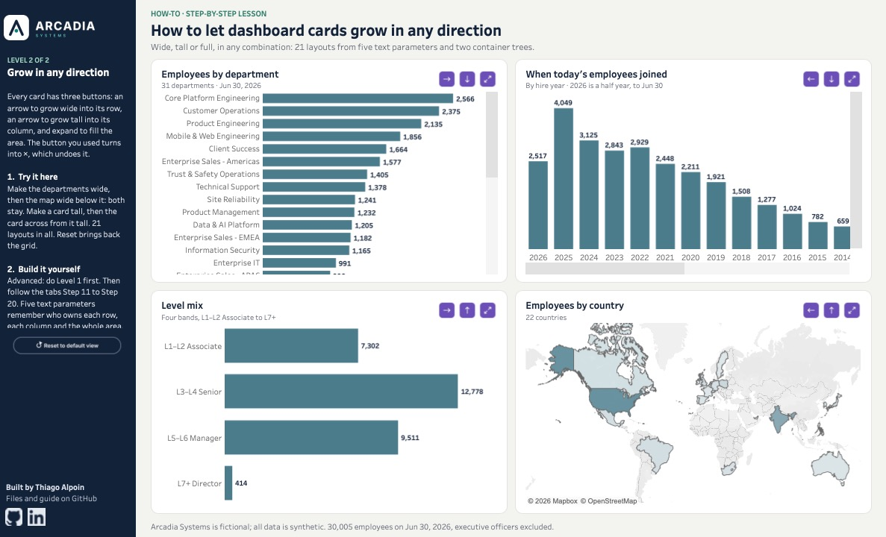

# How-To #3: dashboard cards that expand, close and grow in any direction

Give every card on a 2 × 2 dashboard a button that lets it borrow the space of the others, so a chart too big for its corner can be read in full. **Level 1:** one button per card, expand to the whole area and close again. **Level 2 (advanced):** each card can also grow wide into its row, tall into its column, or full, and moves combine: 21 layouts from four cards. Every step is a parameter, a calculation, a container or a click in Tableau, and you build one card all the way before copying it to the others.

**[▶ Try it live on Tableau Public](https://public.tableau.com/app/profile/thialp/viz/Howtomakedashboardcardsexpandandclose/Level2Growinanydirection)**

## ⬇️ Download

**[Download everything (card-zoom-files.zip)](https://github.com/thialp/tableau-how-to/raw/main/03-card-zoom/card-zoom-files.zip)**, under 1 MB: the data (`arcadia_employees.csv`, the same file as How-To #1) and the images (folder `Arcadia How-To`).

## Get started

1. Unzip the file.
2. Move the folder **Arcadia How-To** into `Documents/My Tableau Repository/Shapes/` (on Windows, `Documents\My Tableau Repository\Shapes\`), replacing How-To #1's or #2's folder if you have it (this one holds all their images plus the six buttons in two colors), then restart Tableau.
3. Open a new Tableau workbook, connect to `arcadia_employees.csv`, and follow the steps.

## The steps

- **In Tableau:** download the workbook from [Tableau Public](https://public.tableau.com/app/profile/thialp/viz/Howtomakedashboardcardsexpandandclose/Level2Growinanydirection) (the download icon under the viz) and open its tabs **Step 1** to **Step 20**. Each sheet's caption, on its left, has that step's instructions and every formula to paste.
- **On this page:** the same 20 steps, with the reasons behind them, are in the **[step-by-step guide](GUIDE.md)**.
- **Level 1** (Steps 1–10, about an hour) is for everyone. **Level 2** (Steps 11–20, about an hour and a half) is advanced: do Level 1 first.

## A note on the icons

The buttons are what the lesson is about, so it uses a purple set to make them easy to spot. On a real dashboard the quiet gray set usually fits better: both are in the zip, and the workbook shows the quiet set on its tab **Quiet icons**. Switching is a shape reassignment; nothing else changes.

## Use it on your own data

The zoom doesn't care what's inside the cards: swap any card sheet for one of yours and every button keeps working. The containers, parameters and actions never read the sheet names.

---

Arcadia Systems is a fictional company; all data is synthetic. Level 1 builds on Jan Kaiser's [Dynamic Zone Zooming in 7 Steps](https://www.thedataschool.de/jan-kaiser/dynamic-zone-zooming-in-7-steps/) (The Data School), from an idea by Samuel Parsons. Images: the Arcadia design system ([Figma UI kit](https://www.figma.com/community/file/1690422855000144024)). Built by Thiago Alpoin · [LinkedIn](https://www.linkedin.com/in/thiagoalpoin) · MIT License.
